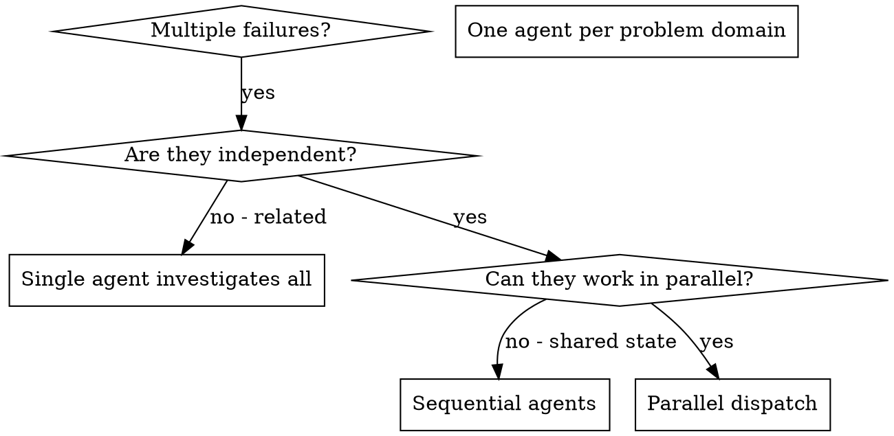

# Parallel mode

Follow the package policy linked from this skill's router before acting.

<a id="src-dispatching-parallel-agents-intro"></a>

<a id="src-dispatching-parallel-agents-dispatching-parallel-agents"></a>
## Dispatching Parallel Agents

<a id="src-dispatching-parallel-agents-overview"></a>
### Overview

Subagents get isolated context you construct precisely — for the full rationale, see subagent mode's "Why subagents" paragraph.

When you have multiple unrelated failures (different test files, different subsystems, different bugs), investigating them sequentially wastes time. Each investigation is independent and can happen in parallel.

**Core principle:** Dispatch one agent per independent problem domain. Let them work concurrently.

<a id="src-dispatching-parallel-agents-when-to-use"></a>
### When to Use



**Use when:**
- 2+ test files failing with different root causes
- Multiple subsystems broken independently
- Each problem can be understood without context from others
- No shared state between investigations

**Don't use when:**
- Failures are related (fix one might fix others)
- Need to understand full system state
- Agents would interfere with each other

<a id="src-dispatching-parallel-agents-the-pattern"></a>
### The Pattern

<a id="src-dispatching-parallel-agents-1-identify-independent-domains"></a>
#### 1. Identify Independent Domains

Group failures by what's broken:
- File A tests: Tool approval flow
- File B tests: Batch completion behavior
- File C tests: Abort functionality

Each domain is independent - fixing tool approval doesn't affect abort tests.

Domains must map to disjoint files; if they can't, run sequentially or give each agent its own worktree (the package's worktree workflow).

<a id="src-dispatching-parallel-agents-2-create-focused-agent-tasks"></a>
#### 2. Create Focused Agent Tasks

Each agent gets:
- **Specific scope:** One test file or subsystem
- **Clear goal:** Make these tests pass
- **Constraints:** Don't change other code
- **Expected output:** Summary of what you found and fixed

<a id="src-dispatching-parallel-agents-3-dispatch-in-parallel"></a>
#### 3. Dispatch in Parallel

Issue all three subagent dispatches in the same response — they run in parallel. Use the host's general-purpose worker role or its closest equivalent:

```text
Worker: "Fix agent-tool-abort.test.ts failures"
Worker: "Fix batch-completion-behavior.test.ts failures"
Worker: "Fix tool-approval-race-conditions.test.ts failures"
# All three run concurrently.
```

Multiple dispatch calls in one response = parallel execution. One per response = sequential.

<a id="src-dispatching-parallel-agents-4-review-and-integrate"></a>
#### 4. Review and Integrate

When agents return:
- Read each summary
- Verify fixes don't conflict
- Run full test suite
- Integrate all changes

<a id="src-dispatching-parallel-agents-agent-prompt-structure"></a>
### Agent Prompt Structure

Good agent prompts are:
1. **Focused** - One clear problem domain
2. **Self-contained** - All context needed to understand the problem
3. **Specific about output** - What should the agent return?

```markdown
Fix the 3 failing tests in src/agents/agent-tool-abort.test.ts:

1. "should abort tool with partial output capture" - expects 'interrupted at' in message
2. "should handle mixed completed and aborted tools" - fast tool aborted instead of completed
3. "should properly track pendingToolCount" - expects 3 results but gets 0

These are timing/race condition issues. Your task:

1. Read the test file and understand what each test verifies
2. Identify root cause - timing issues or actual bugs?
3. Fix by:
   - Replacing arbitrary timeouts with event-based waiting
   - Fixing bugs in abort implementation if found
   - Adjusting test expectations if testing changed behavior

Do NOT just increase timeouts - find the real issue.

Return: Summary of what you found and what you fixed.
```

<a id="src-dispatching-parallel-agents-common-mistakes"></a>
### Common Mistakes

**❌ Too broad:** "Fix all the tests" - agent gets lost
**✅ Specific:** "Fix agent-tool-abort.test.ts" - focused scope

**❌ No context:** "Fix the race condition" - agent doesn't know where
**✅ Context:** Paste the error messages and test names

**❌ No constraints:** Agent might refactor everything
**✅ Constraints:** "Do NOT change production code" or "Fix tests only"

**❌ Vague output:** "Fix it" - you don't know what changed
**✅ Specific:** "Return summary of root cause and changes"

<a id="src-dispatching-parallel-agents-real-example-from-session"></a>
### Real Example from Session

6 test failures across 3 files after refactoring; one agent per file:

- Agent 1: Replaced timeouts with event-based waiting
- Agent 2: Fixed event structure bug (threadId in wrong place)
- Agent 3: Added wait for async tool execution to complete

<a id="src-dispatching-parallel-agents-verification"></a>
### Verification

After agents return:
1. **Review each summary** - Understand what changed
2. **Check for conflicts** - Did agents edit same code?
3. **Run full suite** - Verify all fixes work together
4. **Spot check** - Agents can make systematic errors
