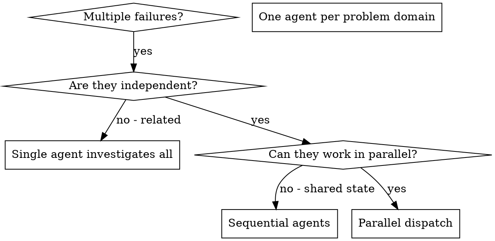

# Skill: devsuite-implement

- Plugin: `winrecoveryproject-devsuite` (0.7.0)
- Source: `plugins/winrecoveryproject-devsuite/skills/devsuite-implement/SKILL.md`

> Use when authorized to implement, refactor, migrate or maintain software with bounded changes and fresh evidence; executing a written implementation plan inline task by task, or by dispatching one subagent per task with review gates; building scoped code changes from an approved spec, plan or tickets (even if the user doesn't say "implement"); executing a full specification across ticket branches into one unified PR ("build the whole spec"); dispatching one subagent per independent problem that can run concurrently; or running long, interruption-prone work from a durable state file with falsifiable criteria. Do NOT use for initial architecture exploration, vague requirements, or planning work that has no plan yet (use devsuite-planning).

## Instructions

### Implement the accepted behavior

<a id="policy"></a>
Read [the policy](_plugin-references.md#file-referencespolicymd) and applicable [platform guidance](_plugin-references.md#file-referencesplatformsmd). Establish observable acceptance criteria, authorized files/interfaces/environments, preserved invariants, highest-risk failures and completion evidence. Inspect current status/diff and nearby implementation/tests. Use repository-native patterns and documented commands.

Pick one mode and read only its file. Bounded implementation, refactoring, migration and maintenance below is the `build` mode.

| Mode | Use when | Read |
|---|---|---|
| <a id="mode-execute"></a>execute | Execute a written plan inline, task by task, stopping only on blockers | [modes/execute.md](devsuite-implement.md#file-modesexecutemd) |
| <a id="mode-subagent"></a>subagent | Execute a plan with one subagent per task and per-task review gates | [modes/subagent.md](devsuite-implement.md#file-modessubagentmd) |
| <a id="mode-implement"></a>implement | Build scoped code changes from an approved spec, plan or tickets and verify them | [modes/implement.md](devsuite-implement.md#file-modesimplementmd) |
| <a id="mode-spec-run"></a>spec-run | Execute a full specification across ticket branches into one unified PR | [modes/spec-run.md](devsuite-implement.md#file-modesspec-runmd) |
| <a id="mode-parallel"></a>parallel | Dispatch one subagent per independent problem that can run concurrently | [modes/parallel.md](devsuite-implement.md#file-modesparallelmd) |
| <a id="mode-durable"></a>durable | Run long or interruption-prone work from a durable state file with evidence | [modes/durable.md](devsuite-implement.md#file-modesdurablemd) |
| <a id="mode-build"></a>build | Authorized bounded implementation, refactor, migration or maintenance with fresh evidence | this file, below |

In this package, the review skill is [devsuite-review](devsuite-review.md) (code and verify modes), the debugging workflow is [devsuite-debug](devsuite-debug.md), handoff is [devsuite-handoff](devsuite-handoff.md), and the worktree and branch-finishing workflows are [devsuite-git](devsuite-git.md) (worktree and finish modes). DevSuite has no dedicated refactoring, research or UI-automation workflow and no Windows process-execution reference: use the platform guidance instead, and report those layers as unavailable when a mode asks for them.

The mode files and everything under `modes/subagent/` are shared byte-for-byte with Plugin-Skill-Studio `studio-execute`. Change them only together with Studio, and update `references/consolidation/shared-execute-modes.json` in both packages. The subagent scripts need bash and git.

<a id="src-devsuite-implement-build"></a>
A feature starts with a thin vertical slice; a defect follows [debugging](devsuite-debug.md); a refactor characterizes behavior; a migration maps producers/consumers, compatibility window, data transitions and rollback. Name concurrency, persistence, security, time and network failure boundaries where relevant. Use [engineering decisions](_plugin-references.md#file-referencesengineering-decisionsmd) when selecting test levels and investigations.

For each behavior, demonstrate the missing/wrong behavior by focused failing check or deterministic reproduction where practical; confirm the intended failure cause. Make the smallest coherent change, verify it, and improve structure while green. Expected values come from requirements or independent invariants. Prefer real collaborators when safe and stable seams when isolation is needed. Preserve valid pre-existing work even if it was not developed test-first.

Inspect each slice for accidental API/data changes, copied secrets, generated noise, weak errors and unrelated edits. Do not replace a binding decision with a workaround. Resolve material ambiguity before dependent work while continuing independent work.

For authorized parallelism, partition write surfaces, serialize shared interfaces/migrations/generated outputs and verify combined results directly. No skill automatically creates another chat or agent. Run affected regression/unit/integration tests, project lint/type/build checks and meaningful runtime/migration/recovery checks proportionate to risk. Apply [review gate mode](devsuite-review.md#file-modesgatemd) once; preserve failures and classify product/test/environment/flaky/pre-existing/unresolved causes. Report behavior, checks, compatibility decisions and gaps.

## Bundled files

### File: `agents/openai.yaml`

```yaml
interface:
  display_name: "DevSuite · Implementering"
  short_description: "Byg og refaktorér med tydelige acceptkriterier."
  icon_small: "./assets/wrp-icon-128.png"
  icon_large: "./assets/wrp-icon-256.png"
  brand_color: "#00BDA5"
  default_prompt: "Brug $devsuite-implement til denne opgave, og bevar de eksisterende forbindelser og budgettet på 0 kr."
```

### File: `assets/dispatching-parallel-agents-wrp-icon-128.png`

_Binary asset, not embedded._

### File: `assets/dispatching-parallel-agents-wrp-icon-256.png`

_Binary asset, not embedded._

### File: `assets/execute-durably-wrp-icon-128.png`

_Binary asset, not embedded._

### File: `assets/execute-durably-wrp-icon-256.png`

_Binary asset, not embedded._

### File: `assets/executing-plans-wrp-icon-128.png`

_Binary asset, not embedded._

### File: `assets/executing-plans-wrp-icon-256.png`

_Binary asset, not embedded._

### File: `assets/icon.png`

_Binary asset, not embedded._

### File: `assets/subagent-driven-development-wrp-icon-128.png`

_Binary asset, not embedded._

### File: `assets/subagent-driven-development-wrp-icon-256.png`

_Binary asset, not embedded._

### File: `assets/wrp-icon-128.png`

_Binary asset, not embedded._

### File: `assets/wrp-icon-256.png`

_Binary asset, not embedded._

### File: `modes/durable.md`

#### Durable mode

Follow the package policy linked from this skill's router before acting.

<a id="src-execute-durably-intro"></a>

<a id="src-execute-durably-execute-durably"></a>
##### Execute Durably

Use durable state only when its recovery value exceeds its overhead. Keep state outside the repository so the project never acquires workflow artifacts.

For finite process execution on Windows, read the package's Windows process-execution reference, when available.
Do not invoke a macOS/Linux-only process controller or install another runtime
just because this workflow needs a job handle. Use the current host's supported
execution/session tools; distinguish session tracking from machine-scoped durability.

<a id="src-execute-durably-1-initialize-the-state-file"></a>
###### 1. Initialize the state file

Create one state file per session (markdown or JSON) in a scratch directory or user-level location outside the repo. It holds:

- **Objective**: the complete outcome, stated once.
- **Criteria**: numbered and falsifiable. Each names the exact command or observation that proves it and what failure would look like. A criterion you cannot fail is not a criterion.
- **Per-criterion status**: `pending -> in_progress -> claimed -> verified`. Side exits: `failed`, `rejected`, `stale` — each reopens to `pending` with a written reason, never silently.
- **Evidence log**: append-only. Never rewrite or delete an entry; correct by appending a new one.

Order criteria tracer-first: the first criterion proves a thin end-to-end slice through every layer involved. Thicken behind proven wiring; do not perfect one layer while its connection to the next is a guess.

Evidence is bound to the source it was captured against. Any later source change makes prior evidence stale: rerun the check and re-verify before closing.

<a id="src-execute-durably-2-resume-from-state-not-memory"></a>
###### 2. Resume from state, not memory

At the start of every later turn — and always after compaction or interruption — reread the state file before acting. Continue the first unresolved criterion. Do not rebuild the plan from memory; when memory and state disagree, state wins. The log, not recollection, says what has been proven.

<a id="src-execute-durably-3-record-evidence-verbatim"></a>
###### 3. Record evidence verbatim

Append one log entry per check:

- **Executable check**: exact command, exit code, and the decisive output lines copied verbatim. Paraphrased output is not evidence. Only a zero exit code is eligible to support a claim.
- **Visual, web, or desktop check**: screenshot or artifact path plus one line stating what it shows. Capture such evidence with the package's UI-automation workflow, when available; it supports a behavioral criterion only alongside the executable check, and stays `claimed` until verified.
- **Navigation or research findings**: record why files, tests, or sources were selected — but discovery evidence never completes a behavioral criterion by itself.

A successful check makes a criterion `claimed`, never `verified`.

**Red/green for any bug fix or regression test:**

1. Run the test before touching source and log the failing run: command, nonzero exit, failure lines. A test that already passes, a syntax error, a broken fixture, or invented output is not red.
2. Change the source only after red is on record.
3. Rerun the *identical* command and log the passing run. A changed command or unchanged source voids the cycle.

**Upstream-bug claims**: before blaming a framework, library, or host, rule out this project's own code. The claim requires a minimal reproduction outside the project, logged as evidence like any other.

<a id="src-execute-durably-4-delegate-with-work-packets-medium-or-large-work-only"></a>
###### 4. Delegate with work packets (medium or large work only)

For implementation that splits into independent file sets, write one dependency-aware packet plan before starting workers. Do not use packets for a focused edit. Each packet declares:

- **id, objective, owned paths** — one owner per file set; no ownership overlap between packets; coupled edits stay under one owner rather than being forced apart.
- **dependencies** — no cycles; start a packet only after its dependencies complete.
- **invariants, checks** (exact commands), **integration notes**.

A packet completes only when its declared checks pass against its current owned files. Later changes inside a completed packet's ownership invalidate it: reopen it and its dependents, rerun checks in dependency order. Packet checks are scoped implementation gates; they never replace integrated criteria or independent verification. Completing the last packet leaves the session open — run the integrated criterion checks and verify them independently.

**Delegation contract** (fresh subagents; applies with or without packets): every assignment names the deliverable, minimum context, owned paths, permissions, executable check, and stop conditions. Every worker reports status, changed paths, commands actually run with exit codes, blockers, and remaining risks — missing fields are an invalid result, not implied success. Workers modify only owned paths and never verify work they touched. Give an investigator a question, not a remedy; a diagnosis that arrives pre-committed to a fix is the failure this exists to prevent. A researcher binds every finding to its source and version, and reports disagreeing sources as disagreement. A reviewer returns findings against a named standard, never a completion verdict; "nothing found" is valid, a manufactured minor finding is not. Split test writer from executor only when their edits cannot overlap; otherwise one executor keeps both and preserves the red/green record. Allow at most one classified retry per delegated unit, and re-evaluate the plan after each wave.

<a id="src-execute-durably-5-verify-independently"></a>
###### 5. Verify independently

Before any criterion moves `claimed -> verified`, a fresh subagent or second independent context inspects: the objective, the relevant diff, the criterion, and its evidence entries — without being told the expected verdict. Verdicts are `confirmed`, `rejected`, or `inconclusive`; only `confirmed` closes.

- Self-verification never closes a criterion.
- A different name without a fresh context is not independence; the verifier must not have seen the desired conclusion.
- The verifier is read-only and distinct from everyone whose work it reviews.
- Verification against stale evidence is invalid: rerun first.

<a id="src-execute-durably-execution-discipline"></a>
###### Execution discipline

Rules that hold across every criterion, checkable against the diff and the log:

- **One authority per fact.** Before adding a constant, format, or rule, find its existing owner. Two authorities for one fact is itself a finding; a third blocks completion until one owner remains.
- **One concern per diff.** A diff serves the concern its criterion names. Unrelated edits split out or revert; coupled edits stay under one owner.
- **Crash early.** An impossible state raises a domain error at the point of detection, naming the failing thing. Code that limps past a detected impossibility fails review even with passing tests.
- **Suspect this repository first** — see section 3's upstream-bug rule.
- **Tracer first** — see section 1's criterion ordering.

<a id="src-execute-durably-6-close-only-through-the-gate"></a>
###### 6. Close only through the gate

Complete the session only when every criterion is `verified` and no evidence is stale. Any pending, failed, blocked, rejected, inconclusive, or stale criterion blocks completion — there is no retry-limit or fail-open escape. Do not create commits, branches, PRs, security reviews, or publications unless the user asked for them.

<a id="src-execute-durably-pause-points"></a>
###### Pause points

DO-CONFIRM: work from judgment, then stop at each point and confirm every item. An unconfirmed item goes in the report, never silently past it.

**Before the first evidence entry**
- Criteria are falsifiable and ordered so the first proves end-to-end wiring.
- State file lives outside the repository; resume reads state, not memory.

**Before each criterion closes**
- Evidence shows the real command, exit code, and verbatim decisive output.
- The diff serves one concern and introduced no second authority for any fact.
- A different, fresh verifier confirmed the evidence without a suggested verdict.

**Before completing the session**
- Every criterion verified; none pending, stale, or inconclusive.
- Upstream-bug claims carry an out-of-project reproduction.
- No commit, branch, or publication happened without an explicit request.

<a id="src-execute-durably-boundaries"></a>
###### Boundaries

This skill governs durability and proof, not the work itself. Debugging method belongs to the package's debugging workflow; safe restructuring to its refactoring workflow; auditing a finished delivery claim to its review verify mode; web and desktop evidence capture to its UI-automation workflow; version-bound documentation lookup to its research workflow. Following a written implementation plan's task sequence is execute mode / subagent mode; this skill supplies the durable state and evidence discipline underneath long work.

### File: `modes/execute.md`

#### Execute mode

Follow the package policy linked from this skill's router before acting.

<a id="src-executing-plans-intro"></a>

<a id="src-executing-plans-executing-plans"></a>
##### Executing Plans

<a id="src-executing-plans-overview"></a>
###### Overview

Load plan, review critically, execute all tasks, report when complete.

**Announce at start:** "I'm using execute mode to implement this plan."

**Routing:** Use this skill when subagent dispatch is unavailable OR the user wants a separate execution session; otherwise use subagent mode.

<a id="src-executing-plans-the-process"></a>
###### The Process

<a id="src-executing-plans-step-1-load-and-review-plan"></a>
###### Step 1: Load and Review Plan
1. Ensure an isolated workspace: use the package's worktree workflow to create one or verify the existing one
2. Read plan file
3. Review critically - identify any questions or concerns about the plan
4. If concerns: Raise them with the user before starting
5. If no concerns: Create todos for the plan items and proceed

<a id="src-executing-plans-step-2-execute-tasks"></a>
###### Step 2: Execute Tasks

For each task:
1. Mark as in_progress
2. Follow each step exactly (plan has bite-sized steps)
3. Run verifications as specified
4. Mark as completed

Track completed tasks in a ledger file (reuse subagent mode's convention: `<workspace>/progress.md`, first line naming the plan file, one `Task <N>: complete` line per finished task) so a compacted session can resume where it stopped.

<a id="src-executing-plans-step-3-complete-development"></a>
###### Step 3: Complete Development

After all tasks complete and verified:
- Before claiming the work is done, apply the package's review verify mode: run the verification commands and confirm their output first
- Announce: "I'm using the branch-finishing workflow to complete this work."
- **REQUIRED SUB-SKILL:** Use the package's branch-finishing workflow
- Follow that skill to verify tests, present options, execute choice

<a id="src-executing-plans-when-to-stop-and-ask-for-help"></a>
###### When to Stop and Ask for Help

**STOP executing immediately when:**
- Hit a blocker (missing dependency, test fails, instruction unclear)
- Plan has critical gaps preventing starting
- You don't understand an instruction
- Verification fails repeatedly

**Ask for clarification rather than guessing.**

<a id="src-executing-plans-when-to-revisit-earlier-steps"></a>
###### When to Revisit Earlier Steps

**Return to Review (Step 1) when:**
- The user updates the plan based on your feedback
- Fundamental approach needs rethinking

**Don't force through blockers** - stop and ask.

<a id="src-executing-plans-remember"></a>
###### Remember
- Review plan critically first
- Follow plan steps exactly
- Don't skip verifications
- Reference skills when plan says to
- Stop when blocked, don't guess
- Never start implementation on main/master branch without explicit user consent

### File: `modes/implement.md`

#### Implement mode

Follow the package policy linked from this skill's router before acting.

<a id="src-implement-intro"></a>

<a id="src-implement-implement"></a>
##### Implement

Execute scoped code changes and thorough verification from an approved specification, plan, or ticket set.

<a id="src-implement-core-principle"></a>
###### Core Principle

> **Implement incrementally via vertical tracer slices, verify at each step, and maintain a green build at every seam.**

---

<a id="src-implement-core-invariants"></a>
###### Core Invariants

1. **Approved Plan or Spec First**: Never start broad implementation on ambiguous or unapproved specs.
2. **Vertical Slice Progress**: Implement in small, testable tracer slices rather than mass horizontal file edits.
3. **Continuous Typecheck & Test Verification**: Run local typechecks and single test files after every file modification, and the full suite before completion.
4. **Pre-Commit Quality Gate**: Pass clean code review (the package's review skill (code mode)) and lint checks before committing.
5. **Zero Dead or Speculative Code**: Write strictly the code required to satisfy the spec; avoid speculative abstractions.

---

<a id="src-implement-architecture--map-of-content-moc"></a>
###### Architecture & Map of Content (MOC)

```
[ Review Approved Spec ] ──► [ Order Tracer Slices ] ──► [ TDD Cycle per Slice ] ──► [ Full Suite Verification ] ──► [ Code Review & Commit ]
```

| Phase | Responsibility | Key Action |
|---|---|---|
| **1. Preparation** | Read spec, identify dependencies, check existing test seams | Verify repo builds cleanly before touching code |
| **2. Tracer Execution** | Implement slice-by-slice with TDD | Red-green cycles on target components |
| **3. Continuous Check** | Fast feedback on type errors and single tests | Run targeted test runner after each edit |
| **4. Integration Gate** | End-to-end regression validation | Full test suite, linter, and typecheck pass |
| **5. Delivery** | Review diff against standards and spec | Route to the package's review skill (code mode) and clean commit |

---

<a id="src-implement-step-by-step-procedure-twi"></a>
###### Step-by-Step Procedure (TWI)

<a id="src-implement-step-1-ingest-spec--verify-baseline-cleanliness"></a>
###### Step 1: Ingest Spec & Verify Baseline Cleanliness
- **Action**: Read the spec or ticket descriptions, inspect referenced files, and verify the existing test suite passes cleanly.
- **Key Point**: Never begin adding new features to a broken or failing baseline.
- **Why**: Existing failures confound regression detection for new changes.

<a id="src-implement-step-2-implement-via-vertical-slices-tdd"></a>
###### Step 2: Implement via Vertical Slices (TDD)
- **Action**: For each ticket or component, write failing assertions at public seams, then implement minimal passing logic.
- **Key Point**: Keep edits contained and avoid touching unrelated modules.
- **Inline Checklist**:
  - [ ] Public seam identified and tested
  - [ ] Typecheck passes without errors
  - [ ] Targeted test passes cleanly

<a id="src-implement-step-3-full-test-suite--quality-verification"></a>
###### Step 3: Full Test Suite & Quality Verification
- **Action**: Run the complete project test suite, typechecker, and linter across the entire repository.
- **Key Point**: Zero failures, zero unexpected warnings, zero unformatted files.
- **Why**: Changes in one module can subtly break downstream consumers.

<a id="src-implement-step-4-code-review--final-commit"></a>
###### Step 4: Code Review & Final Commit
- **Action**: Audit the git diff against repository coding standards and original requirements using the package's review skill (code mode).
- **Key Point**: Write a clear, value-communicating commit message summarizing the change.
- **Why**: Durable commit histories preserve architectural reasoning for future maintainers.

---

<a id="src-implement-anti-rationalization-guardrails"></a>
###### Anti-Rationalization Guardrails

| Tempting Rationalization | Binding Rule | Engineering Rationale |
|---|---|---|
| *"I'll edit all 10 files at once before testing anything."* | **Vertical tracer slicing: verify each file/unit immediately.** | Massive multi-file edits make errors difficult to isolate and debug. |
| *"Typechecks are slow, I'll run them at the very end."* | **Run fast targeted checks continuously.** | Catching type errors early prevents building on flawed data signatures. |
| *"The existing test suite was failing before, so ignore it."* | **Establish clean baseline before modifying code.** | Unaccounted failures hide new regressions introduced by the feature. |
| *"Skip code review since the code runs fine."* | **Mandatory diff review against spec and standards.** | Functional code can still violate repository conventions and security standards. |

### File: `modes/parallel.md`

#### Parallel mode

Follow the package policy linked from this skill's router before acting.

<a id="src-dispatching-parallel-agents-intro"></a>

<a id="src-dispatching-parallel-agents-dispatching-parallel-agents"></a>
##### Dispatching Parallel Agents

<a id="src-dispatching-parallel-agents-overview"></a>
###### Overview

Subagents get isolated context you construct precisely — for the full rationale, see subagent mode's "Why subagents" paragraph.

When you have multiple unrelated failures (different test files, different subsystems, different bugs), investigating them sequentially wastes time. Each investigation is independent and can happen in parallel.

**Core principle:** Dispatch one agent per independent problem domain. Let them work concurrently.

<a id="src-dispatching-parallel-agents-when-to-use"></a>
###### When to Use



**Use when:**
- 2+ test files failing with different root causes
- Multiple subsystems broken independently
- Each problem can be understood without context from others
- No shared state between investigations

**Don't use when:**
- Failures are related (fix one might fix others)
- Need to understand full system state
- Agents would interfere with each other

<a id="src-dispatching-parallel-agents-the-pattern"></a>
###### The Pattern

<a id="src-dispatching-parallel-agents-1-identify-independent-domains"></a>
###### 1. Identify Independent Domains

Group failures by what's broken:
- File A tests: Tool approval flow
- File B tests: Batch completion behavior
- File C tests: Abort functionality

Each domain is independent - fixing tool approval doesn't affect abort tests.

Domains must map to disjoint files; if they can't, run sequentially or give each agent its own worktree (the package's worktree workflow).

<a id="src-dispatching-parallel-agents-2-create-focused-agent-tasks"></a>
###### 2. Create Focused Agent Tasks

Each agent gets:
- **Specific scope:** One test file or subsystem
- **Clear goal:** Make these tests pass
- **Constraints:** Don't change other code
- **Expected output:** Summary of what you found and fixed

<a id="src-dispatching-parallel-agents-3-dispatch-in-parallel"></a>
###### 3. Dispatch in Parallel

Issue all three subagent dispatches in the same response — they run in parallel. Use the host's general-purpose worker role or its closest equivalent:

```text
Worker: "Fix agent-tool-abort.test.ts failures"
Worker: "Fix batch-completion-behavior.test.ts failures"
Worker: "Fix tool-approval-race-conditions.test.ts failures"
# All three run concurrently.
```

Multiple dispatch calls in one response = parallel execution. One per response = sequential.

<a id="src-dispatching-parallel-agents-4-review-and-integrate"></a>
###### 4. Review and Integrate

When agents return:
- Read each summary
- Verify fixes don't conflict
- Run full test suite
- Integrate all changes

<a id="src-dispatching-parallel-agents-agent-prompt-structure"></a>
###### Agent Prompt Structure

Good agent prompts are:
1. **Focused** - One clear problem domain
2. **Self-contained** - All context needed to understand the problem
3. **Specific about output** - What should the agent return?

```markdown
Fix the 3 failing tests in src/agents/agent-tool-abort.test.ts:

1. "should abort tool with partial output capture" - expects 'interrupted at' in message
2. "should handle mixed completed and aborted tools" - fast tool aborted instead of completed
3. "should properly track pendingToolCount" - expects 3 results but gets 0

These are timing/race condition issues. Your task:

1. Read the test file and understand what each test verifies
2. Identify root cause - timing issues or actual bugs?
3. Fix by:
   - Replacing arbitrary timeouts with event-based waiting
   - Fixing bugs in abort implementation if found
   - Adjusting test expectations if testing changed behavior

Do NOT just increase timeouts - find the real issue.

Return: Summary of what you found and what you fixed.
```

<a id="src-dispatching-parallel-agents-common-mistakes"></a>
###### Common Mistakes

**❌ Too broad:** "Fix all the tests" - agent gets lost
**✅ Specific:** "Fix agent-tool-abort.test.ts" - focused scope

**❌ No context:** "Fix the race condition" - agent doesn't know where
**✅ Context:** Paste the error messages and test names

**❌ No constraints:** Agent might refactor everything
**✅ Constraints:** "Do NOT change production code" or "Fix tests only"

**❌ Vague output:** "Fix it" - you don't know what changed
**✅ Specific:** "Return summary of root cause and changes"

<a id="src-dispatching-parallel-agents-real-example-from-session"></a>
###### Real Example from Session

6 test failures across 3 files after refactoring; one agent per file:

- Agent 1: Replaced timeouts with event-based waiting
- Agent 2: Fixed event structure bug (threadId in wrong place)
- Agent 3: Added wait for async tool execution to complete

<a id="src-dispatching-parallel-agents-verification"></a>
###### Verification

After agents return:
1. **Review each summary** - Understand what changed
2. **Check for conflicts** - Did agents edit same code?
3. **Run full suite** - Verify all fixes work together
4. **Spot check** - Agents can make systematic errors

### File: `modes/spec-run.md`

#### Spec-run mode

Follow the package policy linked from this skill's router before acting.

<a id="src-implement-spec-intro"></a>

<a id="src-implement-spec-implement-spec"></a>
##### Implement Spec

Orchestrate the parallel implementation of an approved specification and its DAG task graph across isolated subagent branches, culminating in a single unified, code-reviewed pull request.

---

<a id="src-implement-spec-core-invariants"></a>
###### Core Invariants

1. **DAG Frontier Concurrency**: Implementer subagents work exclusively on unblocked frontier tickets; merge completions immediately unlock newly unblocked tickets.
2. **Strict Worktree Isolation**: Every implementer subagent executes in its own dedicated, isolated Git worktree and branch to prevent file collision.
3. **Context Pointers Exclusively**: Communicate to subagents strictly via context pointers (spec path, ticket IDs, ADRs); avoid dumping giant walls of text.
4. **Dedicated Merger Verification**: Merging completed worktree branches into the main PR branch is handled by a merger subagent with full test suite verification.
5. **Unified Code-Review Quality Gate**: Run the package's review skill (code mode) across the unified PR branch before marking it ready for human review, fixing all findings in a final pass.

---

<a id="src-implement-spec-architecture--map-of-content-moc"></a>
###### Architecture & Map of Content (MOC)

```
[ Approved Spec & DAG Tickets ] ──► [ Create PR Branch ] ──► [ Parallel Worktree Subagents ]
                                                                       │
                                      ┌────────────────────────────────┴────────────────────────────────┐
                                      ▼                                                                 ▼
                            [ Ticket #01 Worktree ]                                           [ Ticket #02 Worktree ]
                            - Isolated branch                                                 - Isolated branch
                            - Red/Green TDD cycle                                             - Red/Green TDD cycle
                                      │                                                                 │
                                      └────────────────────────────────┬────────────────────────────────┘
                                                                       ▼
                                                       [ Merge & Verify on PR Branch ]
                                                                       │
                                                                       ▼
                                                       [ Code Review & Worktree Cleanup ]
```

| Role | Responsibility | Execution Mode |
|---|---|---|
| **Exploration Agent** | Pre-read external documentation and shared schemas | Background subagent (`research`) |
| **Implementer Agents** | Execute single tickets inside isolated worktrees | Parallel subagents (`implement`) |
| **Merger Agent** | Merge feature branches into PR branch & verify tests | Serial integration pass |
| **Review Gate** | Run two-axis code review on final PR branch | The package's review skill, code mode |

---

<a id="src-implement-spec-step-by-step-procedure-twi"></a>
###### Step-by-Step Procedure (TWI)

<a id="src-implement-spec-step-1-ingest-task-graph--initialize-pr-branch"></a>
###### Step 1: Ingest Task Graph & Initialize PR Branch
- **Action**: Read the specification and associated tickets to compute the initial unblocked frontier.
- **Key Point**: Create a dedicated PR branch (`feat/<spec-slug>`) and draft pull request linking all target tickets.
- **Why**: Linking tickets upfront ensures automated status tracking and traceability.

<a id="src-implement-spec-step-2-dispatch-parallel-implementer-subagents"></a>
###### Step 2: Dispatch Parallel Implementer Subagents
- **Action**: For each ticket on the unblocked frontier, spawn an implementer subagent in an isolated worktree (`.worktrees/<ticket-slug>`).
- **Key Point**: Pass context pointers to the spec and ticket without duplicating instructions.
- **Inline Checklist**:
  - [ ] Worktrees isolated from main repository workspace
  - [ ] Implementers follow strict TDD red-green cycle
  - [ ] Each implementer works on a single assigned ticket

<a id="src-implement-spec-step-3-merge-completed-tickets--advance-frontier"></a>
###### Step 3: Merge Completed Tickets & Advance Frontier
- **Action**: When an implementer completes, merge its branch into the PR branch, run the test suite, and delete the worktree.
- **Key Point**: Recompute the task graph frontier to launch newly unblocked tickets immediately.
- **Why**: Continuous merging keeps integration diffs small and surfaces conflicts early.

<a id="src-implement-spec-step-4-run-two-axis-code-review--cleanup"></a>
###### Step 4: Run Two-Axis Code Review & Cleanup
- **Action**: Once all tickets are merged, run the package's review skill (code mode) on `feat/<spec-slug>`.
- **Key Point**: Remediate all Standards and Spec findings before marking the PR ready for human review.
- **Why**: Comprehensive pre-merge review guarantees production-grade architecture and full spec compliance.

---

<a id="src-implement-spec-anti-rationalization-guardrails"></a>
###### Anti-Rationalization Guardrails

| Tempting Rationalization | Binding Rule | Engineering Rationale |
|---|---|---|
| *"Run all implementers in the same shared working tree."* | **Mandatory isolated git worktrees per subagent.** | Shared workspaces cause file lock contention, overwrites, and git index corruption. |
| *"Skip code review since all unit tests passed."* | **Mandatory two-axis code review on the final PR branch.** | Passing tests do not catch architectural smells, Fowler anti-patterns, or missed spec clauses. |
| *"Implement blocked tickets before their dependencies merge."* | **Strictly adhere to the DAG frontier.** | Implementing blocked tickets prematurely results in massive merge conflicts and rework. |

### File: `modes/subagent/implementer-prompt.md`

#### Implementer Subagent Prompt Template

Use this template when dispatching an implementer subagent.

```
Host-neutral worker template (translate with references/dispatch-and-model-selection.md):
  task_label: "Implement Task N: [task name]"
  model_override: [MODEL — include only when the host supports explicit overrides;
                   choose per references/dispatch-and-model-selection.md]
  message: |
    You are implementing Task N: [task name]

    ## Task Description

    Read your task brief first: [BRIEF_FILE]
    It contains the full task text from the plan.

    ## Context

    [Scene-setting: where this fits, dependencies, architectural context]

    ## Before You Begin

    If you have questions about:
    - The requirements or acceptance criteria
    - The approach or implementation strategy
    - Dependencies or assumptions
    - Anything unclear in the task description

    **Ask them now.** Raise any concerns before starting work.

    ## Your Job

    Once you're clear on requirements:
    1. Implement exactly what the task specifies
    2. Write tests (following TDD if task says to)
    3. Verify implementation works
    4. Commit your work
    5. Self-review (see below)
    6. Report back

    Work from: [directory]

    **While you work:** If you encounter something unexpected or unclear, **ask questions**.
    It's always OK to pause and clarify. Don't guess or make assumptions.

    While iterating, run the focused test for what you're changing; run the
    full suite once before committing, not after every edit.

    ## Code Organization

    You reason best about code you can hold in context at once, and your edits are more
    reliable when files are focused. Keep this in mind:
    - Follow the file structure defined in the plan
    - Each file should have one clear responsibility with a well-defined interface
    - If a file you're creating is growing beyond the plan's intent, stop and report
      it as DONE_WITH_CONCERNS — don't split files on your own without plan guidance
    - If an existing file you're modifying is already large or tangled, work carefully
      and note it as a concern in your report
    - In existing codebases, follow established patterns. Improve code you're touching
      the way a good developer would, but don't restructure things outside your task.

    ## When You're in Over Your Head

    It is always OK to stop and say "this is too hard for me." Bad work is worse than
    no work. You will not be penalized for escalating.

    **STOP and escalate when:**
    - The task requires architectural decisions with multiple valid approaches
    - You need to understand code beyond what was provided and can't find clarity
    - You feel uncertain about whether your approach is correct
    - The task involves restructuring existing code in ways the plan didn't anticipate
    - You've been reading file after file trying to understand the system without progress

    **How to escalate:** Report back with status BLOCKED or NEEDS_CONTEXT. Describe
    specifically what you're stuck on, what you've tried, and what kind of help you need.
    The controller can provide more context, re-dispatch with a more capable model,
    or break the task into smaller pieces.

    ## Before Reporting Back: Self-Review

    Review your work with fresh eyes. Ask yourself:

    **Completeness:**
    - Did I fully implement everything in the spec?
    - Did I miss any requirements?
    - Are there edge cases I didn't handle?

    **Quality:**
    - Is this my best work?
    - Are names clear and accurate (match what things do, not how they work)?
    - Is the code clean and maintainable?

    **Discipline:**
    - Did I avoid overbuilding (YAGNI)?
    - Did I only build what was requested?
    - Did I follow existing patterns in the codebase?

    **Testing:**
    - Do tests actually verify behavior (not just mock behavior)?
    - Did I follow TDD if required?
    - Are tests comprehensive?
    - Is the test output pristine (no stray warnings or noise)?

    If you find issues during self-review, fix them now before reporting.

    ## After Review Findings

    If the task review finds issues, you will be resumed with the findings.
    Fix them, re-run the tests that cover the amended code, and append a fix
    report to your report file: what you changed, the covering tests you
    ran, the command, and the output. Reviewers will not re-run tests for
    you — your report is the test evidence. Then reply with the same short
    status contract as your first report.

    ## Report Format

    Write your full report to [REPORT_FILE]:
    - What you implemented (or what you attempted, if blocked)
    - What you tested and test results
    - **TDD Evidence** (if TDD was required for this task):
      - RED: command run, relevant failing output before implementation, and why the failure was expected
      - GREEN: command run and relevant passing output after implementation
    - Files changed
    - Self-review findings (if any)
    - Any issues or concerns

    Then report back with ONLY (under 15 lines — the detail lives in the
    report file):
    - **Status:** DONE | DONE_WITH_CONCERNS | BLOCKED | NEEDS_CONTEXT
    - Commits created (short SHA + subject)
    - One-line test summary (e.g. "14/14 passing, output pristine")
    - Your concerns, if any
    - The report file path

    If BLOCKED or NEEDS_CONTEXT, put the specifics in the final message
    itself — the controller acts on it directly.

    Use DONE_WITH_CONCERNS if you completed the work but have doubts about correctness.
    Use BLOCKED if you cannot complete the task. Use NEEDS_CONTEXT if you need
    information that wasn't provided. Never silently produce work you're unsure about.
```

### File: `modes/subagent/re-review-prompt.md`

#### Scoped Re-Review Prompt Template

Use this template when dispatching a re-review after a fix round. The
re-reviewer verifies the findings were addressed and checks the fix diff for
new breakage. It is not a fresh review — the full review already happened.

**Purpose:** Verify each finding from the previous review was addressed, and
that the fix itself broke nothing.

```
Host-neutral worker template (translate with references/dispatch-and-model-selection.md):
  task_label: "Re-review Task N fix round R"
  model_override: [MODEL — include only when the host supports explicit overrides;
                   choose per references/dispatch-and-model-selection.md]
  message: |
    You are re-reviewing one task's fix round. A previous review produced
    findings; an implementer has attempted to fix them. Your job is to
    verdict each finding and inspect the fix diff — nothing else.

    ## The Task

    Read the task brief: [BRIEF_FILE]

    ## The Findings Under Verification

    [FINDINGS]

    ## The Fix

    Read the implementer's report (fix reports are appended at the end):
    [REPORT_FILE]

    **Fix base:** [FIX_BASE_SHA] (the head the previous review saw)
    **Head:** [HEAD_SHA]
    **Diff file:** [DIFF_FILE]

    Read the diff file once — it contains the fix commits, a stat summary,
    and the fix diff with surrounding context. Do not re-run git commands.
    If the diff file is missing, fetch the diff yourself:
    `git diff --stat [FIX_BASE_SHA]..[HEAD_SHA]` and
    `git diff [FIX_BASE_SHA]..[HEAD_SHA]`.

    Your review is read-only on this checkout. Do not mutate the working
    tree, the index, HEAD, or branch state in any way.

    ## Scope

    Your scope is the findings list and the fix diff. Verdict every finding.
    Inspect the fix diff for new problems the fix itself introduced. Do NOT
    re-review code the fix did not touch: if you notice an issue entirely
    outside the fix diff, report it under Out-of-Scope Observations — it
    does not block this task and does not extend the loop. A broad
    whole-branch review happens after all tasks are complete.

    ## Tests

    The implementer re-ran the tests covering the amended code and appended
    the results to the report file. Treat the report as unverified claims:
    confirm the fix report names the covering tests and shows their output,
    and verify the claims against the diff. Do not re-run the suite to
    confirm their report. Run a test only when reading the code raises a
    specific doubt that no existing run answers — and then a focused test,
    never a package-wide suite.

    ## Output Format

    Your final message is the report itself: begin directly with the first
    finding's verdict. Every line is a verdict, a finding with file:line,
    or a check you ran — no preamble, no process narration.

    ### Finding Verdicts

    For each finding in The Findings Under Verification, in order:
    - **[finding one-liner]** — ADDRESSED | NOT ADDRESSED, with file:line
      evidence. "Attempted" is not addressed: the specific defect must no
      longer exist.

    ### New Breakage in the Fix Diff

    Anything the fix itself broke or introduced, with severity
    (Critical/Important/Minor) and file:line. "None" if clean.

    ### Out-of-Scope Observations

    Issues you noticed entirely outside the fix diff. Non-blocking; the
    controller ledgers these for the final review. "None" if none.

    ### Verdict

    **Fix round:** [All findings addressed, no new Critical/Important
    breakage | Findings remain open] — list the open ones.
```

**Placeholders:**
- `[MODEL]` — reviewer model selected from [dispatch-and-model-selection.md](devsuite-implement.md#file-modessubagentreferencesdispatch-and-model-selectionmd) when the host supports explicit overrides; scoped
  re-reviews of small fix diffs take a cheap-to-mid tier
- `[BRIEF_FILE]` — the task brief file (same file the implementer worked from)
- `[FINDINGS]` — the Critical/Important findings and spec gaps from the
  previous review, copied verbatim, one per bullet
- `[REPORT_FILE]` — the implementer's report file (fix reports appended)
- `[FIX_BASE_SHA]` — the head the previous review saw
- `[HEAD_SHA]` — current commit
- `[DIFF_FILE]` — the path `scripts/review-package PLAN_FILE FIX_BASE HEAD` printed

**Re-reviewer returns:** per-finding verdicts (ADDRESSED / NOT ADDRESSED),
new breakage in the fix diff, out-of-scope observations, and a round verdict.

### File: `modes/subagent/references/dispatch-and-model-selection.md`

#### Dispatch and Model Selection

Read this reference before the first worker dispatch and whenever a task changes role or capability needs.

##### Host Dispatch Mapping

Treat the worker templates' `task_label`, `message`, and optional `model_override` as host-neutral fields.

###### Codex

For every fresh worker, call `spawn_agent` with:

```text
task_name: task_n_implement        # stable snake_case label derived from task_label
message: <entire template message>
fork_turns: "none"                # pass only the context constructed in message
model: <model_override>            # include only when overrides are supported and selected
```

Record the returned worker target. For fix rounds 1–3, call `followup_task` with that same `target` and the findings in `message`; keep the original worker while it remains available.

###### ChatGPT and other hosts

Map `task_label` and `message` to the closest general-purpose worker dispatch fields. Include `model_override` only when the host exposes per-worker model selection.

##### Model Selection

Use the least powerful model that can complete the role reliably. Omit the model field when the host does not support overrides.

- Mechanical implementation with a complete specification or a one-to-two-file change: cheap model.
- Multi-file integration, pattern matching, or debugging: standard model.
- Architecture, design, and final whole-branch review: most capable model.
- Task review: match the model's judgment to the diff's size, complexity, and risk; use a mid-tier model as the floor for prose-defined work.
- Scoped re-review of a small fix: cheap-to-mid tier.
- Fix rounds 4–5: at least one tier above the implementer that stalled.

Turn count beats token price. Cheap models that need repeated turns can cost more overall. When the dispatch API supports an override, specify it explicitly so an expensive session default is not inherited accidentally.

Completion criterion: every fresh dispatch uses the correct host fields, isolated context, and an explicitly chosen model whenever the host supports overrides.

### File: `modes/subagent/references/review-and-fix-loop.md`

#### Review and Fix Loop

Read this reference before the first task review. Apply every gate through task completion, then use the final-review section after all tasks finish.

##### Task Review

Per-task review is a task-scoped gate. It never replaces the broad whole-branch review.

1. Run `bash <skill-dir>/modes/subagent/scripts/review-package PLAN_FILE BASE HEAD`, using the BASE recorded before implementation. Use the printed file path; `HEAD~1` can omit earlier commits from a multi-commit task.
2. Dispatch [task-reviewer-prompt.md](devsuite-implement.md#file-modessubagenttask-reviewer-promptmd) with the task brief, implementer report, review package, and binding global constraints.
3. Copy exact values, formats, and relationships from the plan's Global Constraints or specification. The reviewer template already carries process rules.
4. Require both verdicts: spec compliance and task quality. Implementer self-review does not replace either verdict.

The review package keeps the diff out of controller context and gives the reviewer the commit list, stat summary, and full diff in one read. Never dispatch a reviewer without it.

Do not ask the reviewer to repeat tests already evidenced in the implementer report. Add a test request only for a concrete doubt that the existing evidence does not answer. Do not pre-judge findings with instructions such as “do not flag,” “at most Minor,” or “the plan chose.” Let the reviewer raise the issue and adjudicate it through the loop.

A reviewer may return `⚠️ Cannot verify from diff` items. Resolve each one before completing the task. A confirmed gap enters the fix loop as a failed spec review.

Completion criterion: the review contains both verdicts, every `⚠️` item is resolved, and no blocking finding is silently discarded.

##### Route Findings

The fix loop starts on spec `❌`, any Critical or Important finding, or a `⚠️` item confirmed as a real gap.

Two routes leave the loop before a fix dispatch:

- Minor findings: append `Task <N>: minor (deferred): <one-liner>` to the ledger. Point the final review at all deferred minors.
- Plan-mandated defects or findings that conflict with the plan: show the finding beside the binding plan text and ask the user which governs.

Everything else enters the loop. Never fix review findings in the controller session; controller fixes pollute coordination context and skip review.

##### Fix Rounds

One round is one fix dispatch followed by one scoped re-review. Allow five rounds maximum per task.

###### Rounds 1–3

Resume the original implementer with the open findings verbatim. In Codex, use `followup_task` with the original `spawn_agent` target. If the host cannot resume a worker, dispatch a fresh implementer with the brief path, report path, and findings.

###### Rounds 4–5

Dispatch a fresh implementer, using a more capable model when supported. Include the brief path, report path, open findings, and this framing:

> A prior implementer attempted this task [N] times; you own it now. Read the report file for what was tried.

###### Every Round

1. The implementer fixes the findings, runs the focused tests covering the amended code, and appends the change, test command, and output to the existing report file.
2. Confirm that evidence exists before re-review.
3. Record `FIX_BASE`, the head seen by the previous review.
4. Run `bash <skill-dir>/modes/subagent/scripts/review-package PLAN_FILE FIX_BASE HEAD`.
5. Dispatch [re-review-prompt.md](devsuite-implement.md#file-modessubagentre-review-promptmd) with the findings, brief, report, and printed diff path.
6. The re-review verdicts each finding as ADDRESSED or NOT ADDRESSED and checks only the fix diff for new breakage.
7. Ledger out-of-scope observations as deferred minors; they do not extend the loop.
8. Append `Task <N>: fix round <R>/5 (<X> addressed, <Y> open — <finding one-liners>; commits <a7>..<b7>)`.

Completion criterion: the round has covering test evidence, every prior finding has a verdict, new Critical or Important breakage joins the open list, and the ledger records the result.

##### Breaker After Round 5

Stop dispatching after the fifth re-review when findings remain. Adjudicate each one:

- Wrong or contestable finding: `Task <N>: parked — <finding> — ruling: <why the code stands>`.
- Real but not load-bearing: park it with a ruling that records the deferral.
- Real and load-bearing for later tasks, or evidence that the plan is defective: append `Task <N>: BLOCKED — <reason>`, stop, and report the finding, conflicting plan text, and fix history to the user.

Adjudication happens only at the cap, and every ruling belongs in the ledger.

##### Complete the Task

When review is clean, or every remaining finding is parked at the cap, append one completion line:

- `Task <N>: complete (commits <base7>..<head7>, review clean)`
- `Task <N>: complete (commits <base7>..<head7>, <K> parked)`

Mark the task complete only after this line exists. Continue to the next task only when no unadjudicated Critical or Important issue remains.

##### Final Whole-Branch Review

After all tasks complete:

1. Run `bash <skill-dir>/modes/subagent/scripts/review-package PLAN_FILE MERGE_BASE HEAD`, where `MERGE_BASE` is the commit from which the branch started.
2. Dispatch the most capable available model with the code-reviewer prompt of the package's review skill (code mode), the printed package, and pointers to the ledger's deferred-minor and parked lines.
3. If findings remain, dispatch one fix worker with the complete findings list.
4. Run exactly one scoped re-review of that fix wave using `bash <skill-dir>/modes/subagent/scripts/review-package PLAN_FILE FIX_BASE HEAD` and [re-review-prompt.md](devsuite-implement.md#file-modessubagentre-review-promptmd).
5. Park residual non-load-bearing findings with rulings. Surface residual load-bearing findings when the package's branch-finishing workflow presents the integration options.

There is no second final-review fix wave.

Completion criterion: the final review is clean or every residual finding has an explicit ruling, and no load-bearing issue is hidden.

##### Cleanup

After final review and fixes are complete, remove only this plan's workspace. The git history is the record. Leave sibling plan directories intact, then use the package's branch-finishing workflow.

### File: `modes/subagent/references/workflow-example.md`

#### Workflow Calibration

Read this reference when calibrating the controller, diagnosing a stalled loop, or checking the intended end-to-end sequence.

##### Common Failure Modes

| Rationalization | Required response |
|---|---|
| “Close enough on spec compliance” | Fix the gap or reach the cap and adjudicate it. |
| “I will fix it in the controller” | Resume or replace the implementer so the fix receives review. |
| “One more round will converge” | Stop at five rounds and adjudicate. |
| “The reviewer may find something new” | Keep re-review scoped; ledger untouched-code observations. |
| “This finding is obviously wrong” | Adjudicate only at the cap and record the ruling. |
| “The fix is small enough to skip review” | Every fix round ends with a scoped re-review. |
| “Reviews slow the loop” | Treat review as the gate that makes iteration trustworthy. |
| “Ledger bookkeeping is overhead” | Treat the ledger as the recovery source after compaction. |

##### Example Workflow

```text
Controller: use Subagent-Driven Development for the plan.

[Verify isolated workspace]
[Read the plan once]
[Resolve scripts/sdd-workspace PLAN_FILE]
[Create or resume the plan-owned ledger]
[Scan the plan for contradictions]

Task 1
[Record BASE]
[Generate task brief]
[Dispatch implementer with brief and report paths]

Implementer: DONE; committed; focused and final tests pass; report written.

[Generate review package BASE..HEAD]
[Dispatch task reviewer with brief, report, package, and global constraints]

Reviewer: spec compliant; task quality approved.

[Ledger: Task 1 complete with commit range]

Task 2
[Repeat implementation]

Reviewer: spec gap and one Important finding.

[Fix round 1: resume implementer with both findings]
[Implementer appends fix and test evidence]
[Generate scoped FIX_BASE..HEAD review package]
[Dispatch re-reviewer]

Re-reviewer: both findings addressed; no new breakage.

[Ledger fix round and task completion]

[After every task: generate MERGE_BASE..HEAD review package]
[Dispatch final whole-branch reviewer]
[Resolve one final fix wave if needed]
[Remove only this plan's workspace]
[Use the package's branch-finishing workflow]
```

The sequence is complete when every task has a ledger completion line, the final review has no unruled findings, and cleanup targets only the active plan's workspace.

### File: `modes/subagent/scripts/review-package`

```text
#!/usr/bin/env bash
# Generate a review package: commit list, stat summary, and the net
# diff with extended context, written to a file the reviewer reads in one
# call. Using the recorded per-task BASE (not HEAD~1) keeps multi-commit
# tasks intact.
#
# Usage: review-package PLAN_FILE BASE HEAD [OUTFILE]
# Default OUTFILE: <repo-root>/.skillquiver/sdd/<plan-basename>/review-<base7>..<head7>.diff
# (named per range, so a re-review after fixes gets a distinct fresh file).
set -euo pipefail

if [ $# -lt 3 ] || [ $# -gt 4 ]; then
  echo "usage: review-package PLAN_FILE BASE HEAD [OUTFILE]" >&2
  exit 2
fi

plan=$1
base=$2
head=$3
[ -f "$plan" ] || { echo "no such plan file: $plan" >&2; exit 2; }

git rev-parse --verify --quiet "$base" >/dev/null || { echo "bad BASE: $base" >&2; exit 2; }
git rev-parse --verify --quiet "$head" >/dev/null || { echo "bad HEAD: $head" >&2; exit 2; }

if [ $# -eq 4 ]; then
  out=$4
else
  dir=$(bash "$(cd "$(dirname "$0")" && pwd)/sdd-workspace" "$plan")
  out="$dir/review-$(git rev-parse --short "$base")..$(git rev-parse --short "$head").diff"
fi

{
  echo "# Review package: ${base}..${head}"
  echo
  echo "## Commits"
  git log --oneline "${base}..${head}"
  echo
  echo "## Files changed"
  git diff --stat "${base}..${head}"
  echo
  echo "## Diff"
  git diff -U10 "${base}..${head}"
} > "$out"

commits=$(git rev-list --count "${base}..${head}")
echo "wrote ${out}: ${commits} commit(s), $(wc -c < "$out" | tr -d ' ') bytes"
```

### File: `modes/subagent/scripts/sdd-workspace`

```text
#!/usr/bin/env bash
# Resolve and ensure the working-tree directory SDD uses for one plan's
# short-lived artifacts: task briefs, implementer reports, review packages,
# and the progress ledger. Print the plan directory's absolute path.
#
# One directory per plan (.skillquiver/sdd/<plan-basename>-<path-hash>/) so
# plans with the same filename can never read or overwrite each other's
# artifacts. A stale ledger misread as current progress makes controllers
# skip whole task sequences — plan-scoping removes that failure structurally.
#
# The workspace lives in the working tree (not under .git/) because Claude Code
# treats .git/ as a protected path and denies agent writes there — which blocks
# an implementer subagent from writing its report file. A self-ignoring
# .gitignore at .skillquiver/sdd/ keeps every plan's workspace out of
# `git status` and out of accidental commits without modifying any tracked file.
#
# Single source of truth for the workspace location, so task-brief and
# review-package cannot drift to different directories.
#
# Usage: sdd-workspace PLAN_FILE
set -euo pipefail

if [ $# -ne 1 ]; then
  echo "usage: sdd-workspace PLAN_FILE" >&2
  exit 2
fi

plan=$1
[ -f "$plan" ] || { echo "no such plan file: $plan" >&2; exit 2; }

plan_name=$(basename "$plan" .md)
[ -n "$plan_name" ] && [ "$plan_name" != "." ] && [ "$plan_name" != ".." ] \
  || { echo "cannot derive a workspace name from: $plan" >&2; exit 2; }

root=$(git rev-parse --show-toplevel)
root=$(cd "$root" && pwd -P)
plan_path=$(cd "$(dirname "$plan")" && pwd -P)/$(basename "$plan")
case "$plan_path" in
  "$root"/*) plan_key=${plan_path#"$root"/} ;;
  *) plan_key=$plan_path ;;
esac
plan_hash=$(printf '%s' "$plan_key" | git hash-object --stdin)
slug="$plan_name-${plan_hash:0:12}"
base="$root/.skillquiver/sdd"
dir="$base/$slug"
mkdir -p "$dir"
printf '*\n' > "$base/.gitignore"
cd "$dir" && pwd
```

### File: `modes/subagent/scripts/task-brief`

````text
#!/usr/bin/env bash
# Extract one task's full text from an implementation plan into a file the
# implementer reads in one call, so the task text never has to be pasted
# through the controller's context.
#
# Usage: task-brief PLAN_FILE TASK_NUMBER [OUTFILE]
# Default OUTFILE: <repo-root>/.skillquiver/sdd/<plan-basename>/task-<N>-brief.md
# (per plan and per worktree; concurrent runs of the SAME plan in the same
# working tree share it).
set -euo pipefail

if [ $# -lt 2 ] || [ $# -gt 3 ]; then
  echo "usage: task-brief PLAN_FILE TASK_NUMBER [OUTFILE]" >&2
  exit 2
fi

plan=$1
n=$2
[ -f "$plan" ] || { echo "no such plan file: $plan" >&2; exit 2; }

if [ $# -eq 3 ]; then
  out=$3
else
  dir=$(bash "$(cd "$(dirname "$0")" && pwd)/sdd-workspace" "$plan")
  out="$dir/task-${n}-brief.md"
fi

awk -v n="$n" '
  /^```/ { infence = !infence }
  !infence && /^#+[ \t]+Task[ \t]+[0-9]+/ {
    intask = ($0 ~ ("^#+[ \t]+Task[ \t]+" n "([^0-9]|$)"))
  }
  intask { print }
' "$plan" > "$out"

if [ ! -s "$out" ]; then
  echo "task ${n} not found in ${plan} (no heading matching 'Task ${n}')" >&2
  exit 3
fi

echo "wrote ${out}: $(wc -l < "$out" | tr -d ' ') lines"
````

### File: `modes/subagent/task-reviewer-prompt.md`

#### Task Reviewer Prompt Template

Use this template when dispatching a task reviewer subagent. The reviewer
reads the task's diff once and returns two verdicts: spec compliance and
code quality.

**Purpose:** Verify one task's implementation matches its requirements (nothing
more, nothing less) and is well-built (clean, tested, maintainable)

```
Host-neutral worker template (translate with references/dispatch-and-model-selection.md):
  task_label: "Review Task N (spec + quality)"
  model_override: [MODEL — include only when the host supports explicit overrides;
                   choose per references/dispatch-and-model-selection.md]
  message: |
    You are reviewing one task's implementation: first whether it matches its
    requirements, then whether it is well-built. This is a task-scoped gate,
    not a merge review — a broad whole-branch review happens separately after
    all tasks are complete.

    ## What Was Requested

    Read the task brief: [BRIEF_FILE]

    Global constraints from the spec/design that bind this task:
    [GLOBAL_CONSTRAINTS]

    ## What the Implementer Claims They Built

    Read the implementer's report: [REPORT_FILE]

    ## Diff Under Review

    **Base:** [BASE_SHA]
    **Head:** [HEAD_SHA]
    **Diff file:** [DIFF_FILE]

    Read the diff file once — it contains the commit list, a stat summary,
    and the full diff with surrounding context, and it is your view of the
    change. The diff's context lines ARE the changed files: do not Read a
    changed file separately unless a hunk you must judge is cut off
    mid-function — and say so in your report. Do not re-run git commands.
    If the diff file is missing, fetch the diff yourself:
    `git diff --stat [BASE_SHA]..[HEAD_SHA]` and `git diff [BASE_SHA]..[HEAD_SHA]`.
    Do not crawl the broader codebase. Inspect code outside the diff only
    to evaluate a concrete risk you can name — one focused check per named
    risk, and name both the risk and what you checked in your report.
    Cross-cutting changes are legitimate named risks: if the diff changes
    lock ordering, a function or API contract, or shared mutable state,
    checking the call sites is the right method.

    Your review is read-only on this checkout. Do not mutate the working
    tree, the index, HEAD, or branch state in any way.

    ## Do Not Trust the Report

    Treat the implementer's report as unverified claims about the code. It
    may be incomplete, inaccurate, or optimistic. Verify the claims against
    the diff. Design rationales in the report are claims too: "left it per
    YAGNI," "kept it simple deliberately," or any other justification is the
    implementer grading their own work. Judge the code on its merits — a
    stated rationale never downgrades a finding's severity.

    ## Tests

    The implementer already ran the tests and reported results with TDD
    evidence for exactly this code. Do not re-run the suite to confirm their
    report. Run a test only when reading the code raises a specific doubt
    that no existing run answers — and then a focused test, never a
    package-wide suite, race detector run, or repeated/high-count loop. If
    heavy validation seems warranted, recommend it in your report instead of
    running it. If you cannot run commands in this environment, name the
    test you would run.

    Warnings or other noise in the implementer's reported test output are
    findings — test output should be pristine.

    ## Part 1: Spec Compliance

    Compare the diff against What Was Requested:

    - **Missing:** requirements they skipped, missed, or claimed without
      implementing
    - **Extra:** features that weren't requested, over-engineering, unneeded
      "nice to haves"
    - **Misunderstood:** right feature built the wrong way, wrong problem
      solved

    If a requirement cannot be verified from this diff alone (it lives in
    unchanged code or spans tasks), report it as a ⚠️ item instead of
    broadening your search.

    ## Part 2: Code Quality

    **Code quality:**
    - Clean separation of concerns?
    - Proper error handling?
    - DRY without premature abstraction?
    - Edge cases handled?

    **Tests:**
    - Do the new and changed tests verify real behavior, not mocks?
    - Are the task's edge cases covered?

    **Structure:**
    - Does each file have one clear responsibility with a well-defined interface?
    - Are units decomposed so they can be understood and tested independently?
    - Is the implementation following the file structure from the plan?
    - Did this change create new files that are already large, or
      significantly grow existing files? (Don't flag pre-existing file
      sizes — focus on what this change contributed.)

    Your report should point at evidence: file:line references for every
    finding and for any check you would otherwise answer with a bare
    "yes." A tight report that cites lines gives the controller everything
    it needs.

    Your final message is the report itself: begin directly with the
    spec-compliance verdict. Every line is a verdict, a finding with
    file:line, or a check you ran — no preamble, no process narration,
    no closing summary.

    ## Calibration

    Categorize issues by actual severity. Not everything is Critical.
    Important means this task cannot be trusted until it is fixed: incorrect
    or fragile behavior, a missed requirement, or maintainability damage you
    would block a merge over — verbatim duplication of a logic block,
    swallowed errors, tests that assert nothing. "Coverage could be broader"
    and polish suggestions are Minor.
    If the plan or brief explicitly mandates something this rubric calls a
    defect (a test that asserts nothing, verbatim duplication of a logic
    block), that IS a finding — report it as Important, labeled
    plan-mandated. The plan's authorship does not grade its own work; the
    human decides.
    Acknowledge what was done well before listing issues — accurate praise
    helps the implementer trust the rest of the feedback.

    ## Output Format

    ### Spec Compliance

    - ✅ Spec compliant | ❌ Issues found: [what's missing/extra/misunderstood,
      with file:line references]
    - ⚠️ Cannot verify from diff: [requirements you could not verify from the
      diff alone, and what the controller should check — report alongside the
      ✅/❌ verdict for everything you could verify]

    ### Strengths
    [What's well done? Be specific.]

    ### Issues

    #### Critical (Must Fix)
    #### Important (Should Fix)
    #### Minor (Nice to Have)

    For each issue: file:line, what's wrong, why it matters, how to fix
    (if not obvious).

    ### Assessment

    **Task quality:** [Approved | Needs fixes]

    **Reasoning:** [1-2 sentence technical assessment]
```

**Placeholders:**
- `[MODEL]` — reviewer model selected from [dispatch-and-model-selection.md](devsuite-implement.md#file-modessubagentreferencesdispatch-and-model-selectionmd); include only when the host supports explicit overrides
- `[BRIEF_FILE]` — REQUIRED: the task brief file (`scripts/task-brief PLAN N`
  prints the path; same file the implementer worked from)
- `[GLOBAL_CONSTRAINTS]` — the binding requirements copied verbatim from
  the plan's Global Constraints section or the spec: exact values, formats,
  and stated relationships between components (not process rules — those
  are already in this template)
- `[REPORT_FILE]` — REQUIRED: the file the implementer wrote its detailed
  report to
- `[BASE_SHA]` — commit before this task
- `[HEAD_SHA]` — current commit
- `[DIFF_FILE]` — REQUIRED: the path the controller wrote the review
  package to (`scripts/review-package PLAN_FILE BASE HEAD` prints the unique
  path it wrote; the package never enters the controller's context)

**Reviewer returns:** Spec Compliance verdict (✅/❌/⚠️), Strengths, Issues
(Critical/Important/Minor), Task quality verdict

### File: `modes/subagent.md`

#### Subagent mode

Follow the package policy linked from this skill's router before acting.

<a id="src-subagent-driven-development-intro"></a>

<a id="src-subagent-driven-development-subagent-driven-development"></a>
##### Subagent-Driven Development

Execute a plan with one fresh implementer per task, a task-scoped review after each implementation, and one whole-branch review at the end.

This workflow requires isolated worker dispatch. If the host cannot dispatch subagents, use execute mode instead.

**Core principle:** Fresh implementer + spec and quality review + scoped fixes + final review.

**Narration:** Between tool calls, use at most one short line. The ledger and tool results carry the durable record.

**Continuous execution:** Run every task without asking whether to continue. Stop only for an unresolved blocker, ambiguity that prevents safe progress, or completed work.

<a id="src-subagent-driven-development-when-to-use"></a>
###### When to Use

Use this workflow when all are true:

- A decision-complete implementation plan exists.
- Tasks are independent enough for one implementer at a time.
- Work stays in the current session.
- The host supports isolated workers.

Use execute mode for a parallel session. Return to planning when tasks are tightly coupled or the plan is incomplete.

<a id="src-subagent-driven-development-setup"></a>
###### Setup

1. Verify an isolated workspace with the package's worktree workflow. Work on `main` or `master` only with explicit user consent.
2. Invoke this skill's scripts through Bash on every platform because packaging may not preserve executable bits. On Windows, use Git Bash.
3. Resolve the plan workspace:

   ```bash
   bash <skill-dir>/modes/subagent/scripts/sdd-workspace PLAN_FILE
   ```

   The command prints `<repo-root>/.skillquiver/sdd/<plan-basename>-<path-hash>/`. This git-ignored directory owns every artifact for this plan: ledger, briefs, reports, and review packages. Never reuse another plan's directory.
4. Inspect `<workspace>/progress.md`:
   - If its first line names this plan, treat every `Task <N>: complete` line as authoritative and resume at the first incomplete task.
   - If a task ends with a fix-round entry, resume at the next round.
   - If the ledger names another plan, or exists at the obsolete `.superpowers/sdd/progress.md`, leave it intact and create this plan's ledger.
5. Create a missing ledger with `# SDD ledger — plan: <plan file path>` as its first line.
6. Read the plan once, record its context and Global Constraints, and create one todo per task.
7. Before Task 1, scan the complete plan for contradictions between tasks, Global Constraints, and the review rubric. Present all conflicts in one batched question beside the binding plan text. Proceed immediately when the scan is clean.

The ledger is the recovery map after compaction. Trust it and `git log` over conversation memory. `git clean -fdx` destroys this scratch workspace; recover task state from git history if that happens.

Completion criterion: the workspace belongs to the active plan, its ledger identity is correct, completed tasks are not re-dispatched, and every plan conflict is resolved before implementation.

<a id="src-subagent-driven-development-before-the-first-dispatch"></a>
###### Before the First Dispatch

Read [dispatch-and-model-selection.md](devsuite-implement.md#file-modessubagentreferencesdispatch-and-model-selectionmd) before dispatching the first worker. Re-read its model-selection section whenever the role or task complexity changes.

Worker context is constructed, not inherited. Pass only the task's requirements, relevant interfaces, constraints, and artifact paths. Every pasted prompt and worker response remains in controller context; hand large artifacts over as files.

<a id="src-subagent-driven-development-task-loop"></a>
###### Task Loop

Run these steps sequentially for each incomplete task. Never dispatch implementation workers in parallel.

<a id="src-subagent-driven-development-1-dispatch-the-implementer"></a>
###### 1. Dispatch the Implementer

1. Record `BASE` with `git rev-parse HEAD`.
2. Generate the task brief:

   ```bash
   bash <skill-dir>/modes/subagent/scripts/task-brief PLAN_FILE N
   ```

3. Derive the report path from the brief: `task-N-brief.md` becomes `task-N-report.md` in the same workspace.
4. Compose one task dispatch containing:
   - One line explaining where the task fits.
   - The brief path introduced as the requirements and source of exact values.
   - Interfaces and decisions from earlier tasks that the brief cannot know.
   - Any resolved ambiguity.
   - A pointer to each parked ledger finding in an area this task touches.
   - The report path and short return contract.
5. Keep exact values, signatures, and test cases in the brief. Do not paste accumulated task history or send the whole plan.
6. Dispatch with [implementer-prompt.md](devsuite-implement.md#file-modessubagentimplementer-promptmd) using the host mapping and model selected from the dispatch reference.
7. Record the worker identity so fix rounds 1–3 can resume it.

Completion criterion: the worker has isolated context, one task brief, one report path, the necessary prior interfaces, and no unrelated history.

<a id="src-subagent-driven-development-2-handle-the-implementer-status"></a>
###### 2. Handle the Implementer Status

- `DONE`: generate the review package and continue to task review.
- `DONE_WITH_CONCERNS`: read the concerns. Resolve correctness or scope doubts before review; ledger observations and continue.
- `NEEDS_CONTEXT`: provide the missing information and resume the same worker.
- `BLOCKED`: change the conditions before retrying—supply missing context, choose a more capable model, split an oversized task, or escalate a defective plan to the user.

Answer worker questions completely. Never repeat an unchanged dispatch after a worker reports that it is stuck.

Completion criterion: implementation is complete with a report and commit range, or the task has an explicit unresolved blocker.

<a id="src-subagent-driven-development-3-review-the-task"></a>
###### 3. Review the Task

Before the first task review, read [review-and-fix-loop.md](devsuite-implement.md#file-modessubagentreferencesreview-and-fix-loopmd) through “Complete the Task.” Follow it for every review, finding, fix round, re-review, ledger entry, and breaker decision.

Generate the initial package with the `BASE` captured before implementation:

```bash
bash <skill-dir>/modes/subagent/scripts/review-package PLAN_FILE BASE HEAD
```

Dispatch [task-reviewer-prompt.md](devsuite-implement.md#file-modessubagenttask-reviewer-promptmd) with the printed package path, task brief, implementer report, and binding Global Constraints.

- Clean spec and quality verdicts: record task completion.
- Spec gap, Critical or Important finding, or confirmed `⚠️` gap: enter the referenced fix loop.
- Minor finding: defer it in the ledger for final review.
- Finding that conflicts with binding plan text: ask the user which governs.

Completion criterion: the ledger contains a task completion line and no Critical or Important finding remains open without a ruling at the five-round cap.

<a id="src-subagent-driven-development-4-continue"></a>
###### 4. Continue

Mark the task todo complete and move directly to the next incomplete task. The task review is the gate; controller self-review never replaces it.

<a id="src-subagent-driven-development-final-review-and-finish"></a>
###### Final Review and Finish

After every task has a completion line, read “Final Whole-Branch Review” and “Cleanup” in [review-and-fix-loop.md](devsuite-implement.md#file-modessubagentreferencesreview-and-fix-loopmd).

Generate the final review package over `MERGE_BASE..HEAD`, dispatch the most capable available reviewer, resolve at most one final fix wave, and record a ruling for every residual finding. Then remove only this plan's workspace and use the package's branch-finishing workflow.

Completion criterion: every task is complete in the ledger, the final review is clean or all residual findings have rulings, no load-bearing issue is hidden, and only the active plan's workspace is removed.

<a id="src-subagent-driven-development-calibration"></a>
###### Calibration

When the controller stalls, rationalizes skipping a gate, or needs an end-to-end example, read [workflow-example.md](devsuite-implement.md#file-modessubagentreferencesworkflow-examplemd).
