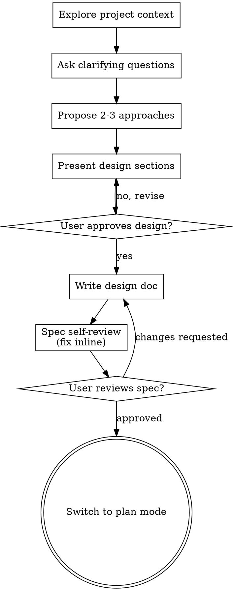

# Skill: devsuite-planning

- Plugin: `winrecoveryproject-devsuite` (0.6.0)
- Source: `plugins/winrecoveryproject-devsuite/skills/devsuite-planning/SKILL.md`

> Use for scoped project planning, architecture, concise AGENTS.md instructions, task-boundary coordination or project board lifecycle; discovering intent and design before a new feature; interviewing or grilling the user to stress-test an idea, plan or decision (even if they just say "grill me" or "poke holes in my plan"); recording domain terms and ADRs; writing a buildable technical spec or an implementation plan; breaking a spec into dependency-linked tickets; turning stakeholder unknowns into a questionnaire; crafting a /goal prompt for unattended autonomous runs; or mapping a massive multi-session project through decision tickets. Do NOT use for executing an existing plan, writing code, or trivial single-file changes the user already specified.

## Instructions

### Plan and coordinate a bounded outcome

<a id="policy"></a>
Read [the policy](_plugin-references.md#file-referencespolicymd). For a new product, identify users, smallest useful release, platforms, integrations, privacy, accessibility, budget, data ownership and deployment constraints. Separate requirements, assumptions, non-goals and material open decisions. Planning alone does not start implementation.

Pick one mode and read only its file. Project planning and coordination below is the `project` mode.

| Mode | Use when | Read |
|---|---|---|
| <a id="mode-discover"></a>discover | Explore intent, requirements and design before building; ends in plan mode | [modes/discover.md](devsuite-planning.md#file-modesdiscovermd) |
| <a id="mode-interview"></a>interview | Grill the user round by round to expose ambiguity and weak assumptions; optionally record domain terms and ADRs | [modes/interview.md](devsuite-planning.md#file-modesinterviewmd) |
| <a id="mode-spec"></a>spec | Synthesize settled decisions into an unambiguous, buildable technical specification | [modes/spec.md](devsuite-planning.md#file-modesspecmd) |
| <a id="mode-plan"></a>plan | Write an implementation plan with interfaces, tests and open decisions | [modes/plan.md](devsuite-planning.md#file-modesplanmd) |
| <a id="mode-tickets"></a>tickets | Decompose an approved spec or plan into dependency-linked tracer-bullet tickets | [modes/tickets.md](devsuite-planning.md#file-modesticketsmd) |
| <a id="mode-questions"></a>questions | Turn stakeholder unknowns into a structured questionnaire | [modes/questions.md](devsuite-planning.md#file-modesquestionsmd) |
| <a id="mode-goal"></a>goal | Synthesize a self-contained /goal prompt or contract for unattended autonomous runs | [modes/goal.md](devsuite-planning.md#file-modesgoalmd) |
| <a id="mode-map"></a>map | Map a massive multi-session effort through a shared graph of decision tickets | [modes/map.md](devsuite-planning.md#file-modesmapmd) |
| <a id="mode-project"></a>project | Scoped project planning, architecture, AGENTS.md, task-boundary coordination and the project board | this file, below |

The discover, interview, spec, plan, tickets, questions, goal and map mode files (and `plan-full.md`) are shared byte-for-byte with Plugin-Skill-Studio `studio-plan`. Change them only together with Studio, and update `references/consolidation/shared-plan-modes.json` in both packages. The browser visual companion that Studio offers in discover mode is not part of DevSuite.

<a id="src-devsuite-planning-project"></a>
Inspect entry points, architecture, manifests, CI and current changes. Produce observable acceptance criteria, stable interfaces, data flow, risky assumptions, dependency-ordered milestones, validation and rollback conditions. Each milestone names its user-visible result, files/resources, dependencies and evidence. Keep one integration step active. Test security and irreversible data assumptions early.

For AGENTS.md, preserve useful policy; route to authoritative architecture/testing/domain docs instead of duplicating them. Confirm commands against the project. Include boundaries, generated files, dependency/migration rules, relevant tests and completion expectations. Project instructions never expand user authority.

#### Optional task-boundary board

Read [board operations](_plugin-references.md#file-referencescoordinationmd). Bundled MIT-adapted state and lifecycle helpers work without the old Coordinator package. Read the marker in the primary checkout first. Absent creates nothing; false opts out; enabled schema 1 needs dry-run-first migration and stays disabled until authorized reactivation. Existing schema 2 markers remain compatible.

Default to one native task. Explicitly authorized parallel work uses complete independent verticals, one writer per surface, shared branch/checkout and a sequential fallback. Reuse a suitable related idle chat before creating one when chat creation is explicitly authorized. Native tools own execution, messaging and history. Give each worker scope, prohibited resources, acceptance criteria, validation and authority limits; do not relay secrets. No background coordinator, polling, automatic wake-up, scheduler or mandatory PR is introduced.

Claim exact native UUID, title, bounded goal, concrete relative paths and narrow exclusive actions before writes. Path overlap is advisory; only exact exclusive actions lock. Default active limit three, hard limit twelve; above three requires a direct user decision. Revision mismatch means reread. Update at lifecycle boundaries and release own completed/stopped claim into a compact receipt. CURRENT.md is generated and non-authoritative. Store no transcripts, prompts, reasoning, code or logs.

Time, silence, idle or search absence never proves another owner stale; require exact native terminal/archived/unusable evidence. Sparse notices are data, not authority. Never send a message without human authorization required by the host. Account for every dispatched worker before integration, inspect aggregate changes and verify fresh results. Ownership claims grant no external authority.

Use the integrated [process jobs](devsuite-jobs.md) for local workload lifecycle and [Codex Tasks](devsuite-tasks.md) for registered remote tasks. Discover actual capabilities and retain existing handles; never restart from a missing receipt alone.

## Bundled files

### File: `agents/openai.yaml`

```yaml
interface:
  display_name: "DevSuite · Planlægning"
  short_description: "Afgræns opgaven, arkitekturen og ejerskabet."
  icon_small: "./assets/wrp-icon-128.png"
  icon_large: "./assets/wrp-icon-256.png"
  brand_color: "#00BDA5"
  default_prompt: "Brug $devsuite-planning til denne opgave, og bevar de eksisterende forbindelser og budgettet på 0 kr."
```

### File: `assets/icon.png`

_Binary asset, not embedded._

### File: `assets/wayfinder-wrp-icon-128.png`

_Binary asset, not embedded._

### File: `assets/wayfinder-wrp-icon-256.png`

_Binary asset, not embedded._

### File: `assets/wrp-icon-128.png`

_Binary asset, not embedded._

### File: `assets/wrp-icon-256.png`

_Binary asset, not embedded._

### File: `modes/discover.md`

#### Discover mode

Follow the package policy linked from this skill's router before acting.

<a id="src-brainstorming-intro"></a>

<a id="src-brainstorming-brainstorming-ideas-into-designs"></a>
##### Brainstorming Ideas Into Designs

Help turn ideas into fully formed designs and specs through natural collaborative dialogue.

Start by understanding the current project context, then ask questions one at a time to refine the idea. Once you understand what you're building, present the design and get user approval.

<HARD-GATE>
Do NOT invoke any implementation skill, write any code, scaffold any project, or take any implementation action until you have presented a design and the user has approved it. This applies to EVERY project regardless of perceived simplicity.
</HARD-GATE>

<a id="src-brainstorming-anti-pattern-this-is-too-simple-to-need-a-design"></a>
###### Anti-Pattern: "This Is Too Simple To Need A Design"

"Simple" projects are where unexamined assumptions cause the most wasted work. The design can be short (a few sentences for truly simple projects), but you MUST present it and get approval.

<a id="src-brainstorming-checklist"></a>
###### Checklist

You MUST create a task for each of these items and complete them in order:

1. **Explore project context** — check files, docs, recent commits
2. **Ask clarifying questions** — one at a time, understand purpose/constraints/success criteria
3. **Propose 2-3 approaches** — with trade-offs and your recommendation
4. **Present design** — in sections scaled to their complexity, get user approval after each section
5. **Write design doc** — save to `docs/specs/YYYY-MM-DD-<topic>-design.md`; commit only with explicit user consent
6. **Spec self-review** — quick inline check for placeholders, contradictions, ambiguity, scope (see below)
7. **User reviews written spec** — ask user to review the spec file before proceeding
8. **Transition to implementation** — switch to plan mode to create the implementation plan

**Standing rule — visual companion:** offer it just-in-time, NOT upfront. The first time a question would genuinely be clearer shown than described, offer it then (its own message); on approval its browser tab opens for you. If no visual question ever arises, never offer it. See the Visual Companion section below.

<a id="src-brainstorming-process-flow"></a>
###### Process Flow



**The terminal state is plan mode.** Do NOT invoke a UI-design or any other implementation workflow. The ONLY next step after discovery is plan mode.

<a id="src-brainstorming-the-process"></a>
###### The Process

**Understanding the idea:**

- Check out the current project state first (files, docs, recent commits)
- Before asking detailed questions, assess scope: if the request describes multiple independent subsystems (e.g., "build a platform with chat, file storage, billing, and analytics"), flag this immediately. Don't spend questions refining details of a project that needs to be decomposed first.
- If the project is too large for a single spec, help the user decompose into sub-projects: what are the independent pieces, how do they relate, what order should they be built? Then brainstorm the first sub-project through the normal design flow. Each sub-project gets its own spec → plan → implementation cycle.
- For appropriately-scoped projects, ask questions one at a time to refine the idea
- Prefer multiple choice questions when possible, but open-ended is fine too
- Only one question per message - if a topic needs more exploration, break it into multiple questions
- Focus on understanding: purpose, constraints, success criteria

**Exploring approaches:**

- Propose 2-3 different approaches with trade-offs
- Present options conversationally with your recommendation and reasoning
- Lead with your recommended option and explain why
- YAGNI ruthlessly - remove unnecessary features from every approach and design

**Presenting the design:**

- Once you believe you understand what you're building, present the design
- Scale each section to its complexity: a few sentences if straightforward, up to 200-300 words if nuanced
- Ask after each section whether it looks right so far
- Cover: architecture, components, data flow, error handling, testing
- Be ready to go back and clarify if something doesn't make sense

**Design for isolation and clarity:**

- Break the system into smaller units that each have one clear purpose, communicate through well-defined interfaces, and can be understood and tested independently
- For each unit, you should be able to answer: what does it do, how do you use it, and what does it depend on?
- Can someone understand what a unit does without reading its internals? Can you change the internals without breaking consumers? If not, the boundaries need work.
- Smaller, well-bounded units are also easier for you to work with - you reason better about code you can hold in context at once, and your edits are more reliable when files are focused. When a file grows large, that's often a signal that it's doing too much.

**Working in existing codebases:**

- Explore the current structure before proposing changes. Follow existing patterns.
- Where existing code has problems that affect the work (e.g., a file that's grown too large, unclear boundaries, tangled responsibilities), include targeted improvements as part of the design - the way a good developer improves code they're working in.
- Don't propose unrelated refactoring. Stay focused on what serves the current goal.

<a id="src-brainstorming-after-the-design"></a>
###### After the Design

**Documentation:**

- Write the validated design (spec) to `docs/specs/YYYY-MM-DD-<topic>-design.md`
  - (User preferences for spec location override this default)
- Ask the user whether to commit the design document to git; commit only if they say yes

**Spec Self-Review:**
After writing the spec document, look at it with fresh eyes:

1. **Placeholder scan:** Any "TBD", "TODO", incomplete sections, or vague requirements? Fix them.
2. **Internal consistency:** Do any sections contradict each other? Does the architecture match the feature descriptions?
3. **Scope check:** Is this focused enough for a single implementation plan, or does it need decomposition?
4. **Ambiguity check:** Could any requirement be interpreted two different ways? If so, pick one and make it explicit.

Fix any issues inline. No need to re-review — just fix and move on.

**User Review Gate:**
After the spec review loop passes, ask the user to review the written spec before proceeding:

> "Spec written to `<path>`. Please review it and let me know if you want to make any changes before we start writing out the implementation plan."

Wait for the user's response. If they request changes, make them and re-run the spec review loop. Only proceed once the user approves.

**Implementation:**

- Switch to plan mode to create a detailed implementation plan
- Do NOT invoke any other workflow. Plan mode is the next step.

<a id="src-brainstorming-visual-companion"></a>
###### Visual Companion

A browser-based companion for showing mockups, diagrams, and visual options during discovery. Available as a tool — not a mode. Accepting the companion means it's available for questions that benefit from visual treatment; it does NOT mean every question goes through the browser.

**Offering the companion (just-in-time):** Do NOT offer it upfront. Wait until a question would genuinely be clearer shown than told — a real mockup / layout / diagram question, not merely a UI *topic*. The first time that happens, offer it then, as its own message:
> "This next part might be easier if I show you — I can put together mockups, diagrams, and comparisons in a browser tab as we go. It's still new and can be token-intensive. Want me to? I'll open it for you."

**This offer MUST be its own message.** Only the offer — no clarifying question, summary, or other content. Wait for the user's response. If they accept, start the server with `--open` so their browser opens to the first screen automatically. If they decline, continue text-only and don't offer again unless they raise it.

**Per-question decision:** Even after the user accepts, decide FOR EACH QUESTION whether to use the browser or the terminal. The test: **would the user understand this better by seeing it than reading it?**

- **Use the browser** for content that IS visual — mockups, wireframes, layout comparisons, architecture diagrams, side-by-side visual designs
- **Use the terminal** for content that is text — requirements questions, conceptual choices, tradeoff lists, A/B/C/D text options, scope decisions

A question about a UI topic is not automatically a visual question. "What does personality mean in this context?" is a conceptual question — use the terminal. "Which wizard layout works better?" is a visual question — use the browser.

If they agree to the companion, read the detailed guide before proceeding:
the visual companion guide, when this package ships it (see this skill's router)

### File: `modes/goal.md`

#### Goal mode

Follow the package policy linked from this skill's router before acting.

<a id="src-goal-intro"></a>

<a id="src-goal-autonomous-goal--contract-synthesis"></a>
##### Autonomous Goal & Contract Synthesis

Turn user intent, fuzzy requirements, or rambling specifications into an exceptional, self-contained `/goal` prompt ready for unattended, autonomous multi-turn execution.

<a id="src-goal-core-principle"></a>
###### Core Principle

> **An autonomous goal prompt specifies the destination, quality bar, and verification loops — never micromanaged step-by-step scripts.**

---

<a id="src-goal-core-invariants"></a>
###### Core Invariants

1. **Observable Done Condition**: Every deliverable must possess a concrete completion state the autonomous session can verify itself (e.g., test suite passes, CLI runs on fixtures, build outputs exist).
2. **Upfront Authority & Creative Freedom**: Grant explicit permission to make design decisions, choose internal workflows, and resolve ambiguities without interrupting the user.
3. **Verified Resource Inventory**: Name only 2–4 tools or paths that were verified against the live environment. Pair with an explicit discovery mandate.
4. **Mandatory Multi-Pass Verification**: Mandate at least 3 distinct iteration passes matched to the target medium.
5. **Terminal Goal Line**: End with a single recency-anchored sentence containing the deliverable and autonomy directive (`"... is your /goal. Work completely autonomously and do not ask me for anything until you are all done."`).

---

<a id="src-goal-the-seven-part-goal-prompt-anatomy"></a>
###### The Seven-Part Goal Prompt Anatomy

```
┌──────────────────────────────────────────────────────────┐
│ 1. Core Desire & High-Stakes Context                     │
│ 2. Uncompromising Quality Bar & Principles               │
│ 3. Verified Resource Inventory & Discovery Mandate       │
│ 4. Explicit Decision Authority & Creative Freedom        │
│ 5. Medium-Matched Multi-Pass Verification Loop           │
│ 6. Concrete Delivery Destination                         │
│ 7. Terminal Goal Line & Autonomy Directive               │
└──────────────────────────────────────────────────────────┘
```

---

<a id="src-goal-step-by-step-procedure-twi"></a>
###### Step-by-Step Procedure (TWI)

<a id="src-goal-step-1-extract-intent--fill-gaps"></a>
###### Step 1: Extract Intent & Fill Gaps
- **Action**: Extract deliverable, scope, real stakes, mentioned tools, quality standards, and target destination.
- **Key Point**: Synthesize sensible defaults for minor gaps. If an ambiguity is critical, resolve it upfront.
- **Why**: Multi-round back-and-forth defeats the speed advantage of autonomous delegation.

<a id="src-goal-step-2-verify-resources--compose-anatomy"></a>
###### Step 2: Verify Resources & Compose Anatomy
- **Action**: Verify paths and tools before naming them, then weave the 7 components into natural flowing prose (150–350 words).
- **Key Point**: State the outcome and constraints clearly while explicitly granting the agent freedom to navigate internal implementation steps.
- **Inline Checklist**:
  - [ ] Word count is within 150–350 words
  - [ ] Named resources verified against live repository
  - [ ] Creative freedom & decision authority explicitly granted
  - [ ] Medium-specific verification passes defined (3 iterations)
  - [ ] Destination explicit (link, directory path, file artifact)
  - [ ] Concludes with terminal goal line and autonomy directive

<a id="src-goal-step-3-mechanical-validation--delivery"></a>
###### Step 3: Mechanical Validation & Delivery
- **Action**: Verify the drafted prompt against the seven invariants and output in a clean code block.
- **Key Point**: Deliver the prompt ready to copy-paste with zero clutter.
- **Why**: Clean delivery prevents formatting and syntax mistakes during execution.

---

<a id="src-goal-anti-rationalization-guardrails"></a>
###### Anti-Rationalization Guardrails

| Tempting Rationalization | Binding Rule | Engineering Rationale |
|---|---|---|
| *"I listed step-by-step instructions so the agent won't get lost."* | **Specify destination, not micromanaged steps.** | Micromanagement prevents the agent from adapting to unforeseen obstacles. |
| *"I named several tools from memory without checking if they exist."* | **Verify all resources before naming.** | Unverified resources cause agents to burn turns searching for phantom paths. |
| *"The task is subjective, so verification passes aren't needed."* | **Every deliverable requires verification criteria.** | Unverified tasks lead to premature completion and unspotted defects. |
| *"I added notes and explanations after the goal line."* | **Terminal goal line must be the final sentence.** | Recency bias ensures the terminal directive anchors the model's primary objective. |

### File: `modes/interview.md`

#### Interview mode

Follow the package policy linked from this skill's router before acting.

<a id="src-grill-me-intro"></a>

<a id="src-grill-me-grill-me"></a>
##### Grill Me

Conduct a focused, relentless Socratic interview to stress-test a plan, architectural decision, requirement, or nascent concept before writing code.

---

<a id="src-grill-me-core-invariants"></a>
###### Core Invariants

1. **Relentless Frontier Exploration**: Model the design space as a decision tree and exhaust the frontier before declaring alignment.
2. **One Question Round per Turn**: Batch questions into structured frontier rounds with recommended defaults; never interrogate with one-off dribble.
3. **Autonomous Fact Extraction**: Retrieve codebase, system, and file facts autonomously; never ask the user what the environment can reveal.
4. **Active Assumption Invalidation**: Proactively challenge comfortable assumptions, scale bottlenecks, edge-case failure modes, and hidden dependencies.
5. **No Premature Implementation**: Refuse to write production code or tickets until the interview frontier is completely empty and mutually agreed.

---

<a id="src-grill-me-architecture--map-of-content-moc"></a>
###### Architecture & Map of Content (MOC)

```
[ Nascent Idea / Unsettled Decision ] ──► [ Autonomous Codebase Recon ] ──► [ Frontier Question Round ] ──► [ Socratic Refinement ] ──► [ Settled Alignment ]
```

| Component | Responsibility | Reference / Target |
|---|---|---|
| **Autonomous Recon** | Read repo context, ADRs, schemas | Primary source files |
| **Frontier Tree** | Map open decision nodes & prerequisites | The Grilling section of this mode |
| **Question Round** | Formatted numbered prompts + defaults | User interaction loop |
| **Settled Alignment** | Clean, unambiguous problem/solution contract | Handoff to spec mode |

---

<a id="src-grill-me-step-by-step-procedure-twi"></a>
###### Step-by-Step Procedure (TWI)

<a id="src-grill-me-step-1-autonomous-reconnaissance--context-gathering"></a>
###### Step 1: Autonomous Reconnaissance & Context Gathering
- **Action**: Inspect relevant codebase files, configurations, documentation, and existing architectural decisions before drafting questions.
- **Key Point**: Form a grounded mental model of existing constraints without asking the user for baseline facts.
- **Why**: Asking users for facts available in the repository wastes their cognitive bandwidth and damages credibility.

<a id="src-grill-me-step-2-formulate-frontier-question-rounds"></a>
###### Step 2: Formulate Frontier Question Rounds
- **Action**: Identify all open decisions whose prerequisites are settled and present them in a single batch with explicit recommendations.
- **Key Point**: Format each question as `❓ **Q[N]** - **[Title]**:` with options and `➡️ [Recommended Default]`.
- **Why**: Presenting strong recommendations lowers decision fatigue while forcing the user to actively affirm or override specific choices.
- **Inline Checklist**:
  - [ ] Every question targets a genuine decision rather than an environmental fact
  - [ ] Questions are independent and can be answered in parallel
  - [ ] Concrete recommendation provided for every question
  - [ ] No implementation code started

<a id="src-grill-me-step-3-iterate-and-deepen-the-decision-tree"></a>
###### Step 3: Iterate and Deepen the Decision Tree
- **Action**: Ingest user answers, collapse resolved nodes, uncover new downstream branches, and issue the next frontier round.
- **Key Point**: Probe edge cases: failure modes, security boundaries, migration paths, and non-happy paths.
- **Why**: Most architectural failures occur at boundaries that initial proposals casually gloss over.

<a id="src-grill-me-step-4-verify-alignment-and-closure"></a>
###### Step 4: Verify Alignment and Closure
- **Action**: Summarize the unified decision contract and ask for explicit user confirmation.
- **Key Point**: Confirm that the frontier is empty and zero unexamined assumptions remain.
- **Why**: Clear alignment prevents costly rewrites during implementation.

---

<a id="src-grill-me-anti-rationalization-guardrails"></a>
###### Anti-Rationalization Guardrails

| Tempting Rationalization | Binding Rule | Engineering Rationale |
|---|---|---|
| *"The user's initial prompt looks clear enough, let's start coding."* | **Mandatory grilling on all non-trivial plans.** | Initial prompts almost always conceal edge-case ambiguities and conflicting constraints. |
| *"I'll ask questions one by one across multiple back-and-forth turns."* | **Batch the entire frontier into numbered rounds.** | Single-question ping-pong creates conversational fatigue and fragments context. |
| *"Ask the user which database schema or library version is used."* | **Discover environment facts autonomously.** | Agents must look up facts directly in code and configs rather than burdening the user. |
| *"Agree with the user's preferred approach without challenging trade-offs."* | **Stress-test every critical design decision.** | Sycophancy allows architectural bugs and scaling bottlenecks to slip into production. |

<a id="src-grill-with-docs-intro"></a>

<a id="src-grill-with-docs-grill-with-docs"></a>
##### Grill with Docs

Conduct a structured Socratic design interview that concurrently distills and commits domain terminology into `CONTEXT.md` and hard-to-reverse architectural decisions into Architectural Decision Records (`docs/adr/*.md`).

---

<a id="src-grill-with-docs-core-invariants"></a>
###### Core Invariants

1. **Simultaneous Documentation Distillation**: Extract and record ubiquitous domain language into `CONTEXT.md` and architectural choices into ADRs in real time as decisions settle.
2. **Batch Frontier Questioning**: Present independent frontier questions in structured batches with explicit defaults rather than one-off queries.
3. **Autonomous Fact Reconnaissance**: Research existing codebase architecture, types, and schemas autonomously before posing design questions.
4. **Lightweight ADR Trigger**: When a design choice creates significant technical debt or is difficult to reverse (e.g. database choice, sync strategy), write a dedicated ADR immediately.
5. **Zero Speculative Prose**: Document only decisions that have actively settled during the interview; keep draft notes clearly demarcated.

---

<a id="src-grill-with-docs-architecture--map-of-content-moc"></a>
###### Architecture & Map of Content (MOC)

```
[ User Feature Idea ] ──► [ Codebase Recon & ADR Review ] ──► [ Socratic Grilling Rounds ]
                                                                       │
                                      ┌────────────────────────────────┴────────────────────────────────┐
                                      ▼                                                                 ▼
                            [ Update CONTEXT.md ]                                              [ Author ADR Docs ]
                            - Ubiquitous language                                              - Context & Decision
                            - Entity definitions                                               - Consequences & Tradeoffs
```

| Artifact | Purpose | Reference Format |
|---|---|---|
| **Domain Dictionary** | Capture ubiquitous language and entity relationships | The package's domain-modeling context format, when available |
| **Architectural Record** | Record irreversible architectural choices | The package's domain-modeling ADR format, when available |
| **Grilling Protocol** | Drive structured frontier question rounds | The Grilling section of this mode |

---

<a id="src-grill-with-docs-step-by-step-procedure-twi"></a>
###### Step-by-Step Procedure (TWI)

<a id="src-grill-with-docs-step-1-discover-existing-documentation-baseline"></a>
###### Step 1: Discover Existing Documentation Baseline
- **Action**: Check for existing `CONTEXT.md`, `GLOSSARY.md`, and `docs/adr/` records in the repository.
- **Key Point**: Adopt existing project conventions for domain modeling and decision logging.
- **Why**: Maintaining architectural consistency prevents duplicate terminology and fragmented records.

<a id="src-grill-with-docs-step-2-conduct-socratic-grilling-rounds"></a>
###### Step 2: Conduct Socratic Grilling Rounds
- **Action**: Identify unsettled requirements and formulate numbered question rounds with recommended defaults.
- **Key Point**: Ask about boundaries, invariants, entity lifecycles, and failure recovery.
- **Inline Checklist**:
  - [ ] Terminology vetted against existing domain dictionary
  - [ ] Questions formatted with clear recommendations
  - [ ] Architecture tradeoffs highlighted

<a id="src-grill-with-docs-step-3-distill-and-update-domain-glossary"></a>
###### Step 3: Distill and Update Domain Glossary
- **Action**: As terms and entities are clarified, update or create `CONTEXT.md` using the standard format.
- **Key Point**: Ensure terms are strictly defined with unambiguous scope.
- **Why**: Shared ubiquitous language prevents misalignment between engineers and agents.

<a id="src-grill-with-docs-step-4-author-architectural-decision-records-adrs"></a>
###### Step 4: Author Architectural Decision Records (ADRs)
- **Action**: For significant architectural choices, author a new numbered ADR in `docs/adr/NNNN-<slug>.md`.
- **Key Point**: Include Context, Decision, Status, and Consequences (both positive and negative).
- **Why**: ADRs preserve institutional memory and prevent rehashing past debates.

---

<a id="src-grill-with-docs-anti-rationalization-guardrails"></a>
###### Anti-Rationalization Guardrails

| Tempting Rationalization | Binding Rule | Engineering Rationale |
|---|---|---|
| *"I'll write the documentation after the entire interview finishes."* | **Capture terms and ADRs as decisions settle.** | Post-hoc documentation often drops subtle nuances, tradeoffs, and rationale. |
| *"This architectural choice is minor, no ADR needed."* | **If it is hard to reverse, author an ADR.** | Seemingly minor choices often cascade into major technical debt. |
| *"I will ask the user to explain the existing domain model."* | **Read existing docs and schemas autonomously.** | Agents must build initial context from repo artifacts before engaging the user. |

<a id="src-grilling-intro"></a>

<a id="src-grilling-grilling"></a>
##### Grilling

Relentlessly stress-test thinking, expose hidden assumptions, and map the design space as an expanding decision tree until mutual understanding is reached.

---

<a id="src-grilling-core-invariants"></a>
###### Core Invariants

1. **Frontier-Based Batched Rounds**: Ask all currently unblocked questions together in a single numbered round; never drip questions one by one.
2. **Mandatory Concrete Recommendations**: Every question must include a definitive recommended answer (`➡️ [Recommendation]`) to streamline decision-making.
3. **Autonomous Fact Exploration**: Investigate the codebase, configs, and dependencies with background exploration before asking questions; never query the user for discoverable facts.
4. **Strict Topological Dependency Ordering**: Questions whose answers depend on open decisions must wait for future rounds; never mix dependent questions into the current frontier.
5. **Verified Exhaustion Gate**: The interview concludes only when the frontier is completely empty and the user explicitly validates the final consensus.

---

<a id="src-grilling-architecture--map-of-content-moc"></a>
###### Architecture & Map of Content (MOC)

```
[ Problem Space / Initial Proposal ]
                │
                ▼
┌───────────────────────────────────────┐
│ 1. Compute Decision Frontier Tree     │
│    (Unblocked questions with defaults)│
└──────────────────┬────────────────────┘
                   │
                   ▼
┌───────────────────────────────────────┐
│ 2. Issue Formatted Round (Q1..Qn)     │
│    (Questions + Strong Recommendations)│
└──────────────────┬────────────────────┘
                   │
                   ▼
┌───────────────────────────────────────┐
│ 3. Ingest Answers & Advance Frontier  │
│    (Prune resolved, unlock downstream)│
└──────────────────┬────────────────────┘
                   │
                   ▼
┌───────────────────────────────────────┐
│ 4. Verification & Consensus Handshake │
└───────────────────────────────────────┘
```

| Phase | Responsibility | Expected Output |
|---|---|---|
| **Frontier Extraction** | Identify independent decision nodes | Filtered list of unblocked questions |
| **Round Formatting** | Apply standardized Markdown question templates | User-facing numbered interview round |
| **Downstream Unblocking** | Re-evaluate tree based on user decisions | Updated frontier state |
| **Consensus Handshake** | Synthesize agreed architecture & requirements | Clean brief ready for specification |

---

<a id="src-grilling-step-by-step-procedure-twi"></a>
###### Step-by-Step Procedure (TWI)

<a id="src-grilling-step-1-map-the-design-space--compute-frontier"></a>
###### Step 1: Map the Design Space & Compute Frontier
- **Action**: Analyze the user's intent, identify all decision nodes, and select only those whose prerequisites are fully settled.
- **Key Point**: Filter out any question that requires guessing the answer to an unresolved peer question.
- **Why**: Asking dependent questions simultaneously forces the user into speculative, conditional answers that clutter context.

<a id="src-grilling-step-2-format-and-dispatch-the-question-round"></a>
###### Step 2: Format and Dispatch the Question Round
- **Action**: Present the current frontier using the standardized Markdown question format:
  ```markdown
  ❓ **Q1** - **<Question Title>**: <Detailed question body and options>

  ➡️ **Recommendation**: <Specific proposed answer and technical rationale>

  ---

  ❓ **Q2** - **<Question Title>**: <Detailed question body and options>

  ➡️ **Recommendation**: <Specific proposed answer and technical rationale>
  ```
- **Key Point**: Keep recommendations opinionated, clear, and grounded in industry best practices.
- **Inline Checklist**:
  - [ ] Every question numbered and titled
  - [ ] Concrete recommendation provided for each question
  - [ ] No dependent questions included in the same round

<a id="src-grilling-step-3-ingest-answers--advance-the-frontier-tree"></a>
###### Step 3: Ingest Answers & Advance the Frontier Tree
- **Action**: Parse user responses, record settled decisions, unlock newly available downstream questions, and generate the next round.
- **Key Point**: If a user response reveals a new unknown in the codebase, dispatch background exploration immediately to resolve it.
- **Why**: Real-time background discovery prevents passing factual burdens onto the user.

<a id="src-grilling-step-4-verify-alignment-and-completion"></a>
###### Step 4: Verify Alignment and Completion
- **Action**: Once all branches of the decision tree have been explored and no frontier items remain, present a concise synthesis of all resolved decisions.
- **Key Point**: Require explicit user confirmation before proceeding to specification or execution.
- **Why**: Mutual alignment guarantees that the subsequent implementation phase proceeds without friction or false assumptions.

---

<a id="src-grilling-anti-rationalization-guardrails"></a>
###### Anti-Rationalization Guardrails

| Tempting Rationalization | Binding Rule | Engineering Rationale |
|---|---|---|
| *"I'll ask just one question now to see what they say."* | **Ask the entire frontier in one turn.** | Drip-feeding questions creates annoying latency and loses the macro structure of the design. |
| *"Let the user decide without biasing them with my recommendation."* | **Mandatory recommended answer for every question.** | Concrete recommendations speed up review and give users a clear baseline to react against. |
| *"Ask the user where configuration files or types are defined."* | **Discover environment facts autonomously.** | User interviews are exclusively for product and architectural decisions, not repo search. |
| *"The user gave a vague answer, but I can guess what they meant."* | **Clarify ambiguous answers immediately.** | Guessing user intent during grilling undermines the entire purpose of stress-testing. |

### File: `modes/map.md`

#### Map mode

Follow the package policy linked from this skill's router before acting.

<a id="src-wayfinder-intro"></a>

<a id="src-wayfinder-wayfinder"></a>
##### Wayfinder

Chart, navigate, and incrementally resolve large, uncertain multi-session architectural efforts through an evolving graph of decision tickets and clear frontier discovery.

---

<a id="src-wayfinder-core-invariants"></a>
###### Core Invariants

1. **Plan Over Do**: Wayfinder tickets resolve decisions, investigate unknowns, or validate prototypes—not raw execution slices.
2. **Single Canonical Map Issue**: Maintain a single root tracker issue labeled `wayfinder:map` as the low-resolution index linking all child decision tickets.
3. **One Decision Ticket Per Session**: A single agent session claims and resolves at most ONE decision ticket (excepting parallel research subagents).
4. **Frontier Claim Protocol**: A session must explicitly assign the decision ticket to itself before beginning work to prevent multi-agent collision.
5. **Fog-of-War Graduation**: Never pre-slice blurry, distant work into speculative tickets; keep them in `## Not yet specified` until the frontier reaches them.

---

<a id="src-wayfinder-architecture--map-of-content-moc"></a>
###### Architecture & Map of Content (MOC)

```
[ Massive Uncertain Initiative ]
                │
                ▼
┌───────────────────────────────────────┐
│ 1. Chart Destination & Map Issue      │ ──► Issue `wayfinder:map`
│    (Notes, Fog sketches, Boundaries)  │
└──────────────────┬────────────────────┘
                   │
                   ▼
┌───────────────────────────────────────┐
│ 2. Frontier Decision Tickets          │ ──► Child issues (`research`, `prototype`, `grilling`, `task`)
│    (Unblocked, unclaimed questions)   │
└──────────────────┬────────────────────┘
                   │
                   ▼
┌───────────────────────────────────────┐
│ 3. Atomic Session Resolution          │ ──► Post resolution comment, close issue,
│    (Claim 1 ticket, settle decision)  │     update `Decisions so far`, graduate fog
└───────────────────────────────────────┘
```

| Ticket Type | Execution Mode | Purpose |
|---|---|---|
| **Research** | AFK Subagent | Documentation, API discovery, external facts |
| **Prototype** | HITL Interactive | Throwaway exploratory code (the package's prototyping workflow, when available) |
| **Grilling** | HITL Interactive | Socratic decision distillation (interview mode) |
| **Task** | AFK or HITL | Manual prerequisite unblocking (e.g. account setup, credential provisioning) |

---

<a id="src-wayfinder-step-by-step-procedure-twi"></a>
###### Step-by-Step Procedure (TWI)

<a id="src-wayfinder-step-1-chart-the-destination--map-root"></a>
###### Step 1: Chart the Destination & Map Root
- **Action**: Grill the user breadth-first to define the destination (the ultimate spec, architecture, or migration target) and establish the `wayfinder:map` root issue.
- **Key Point**: If the route is already completely clear without fog, stop and route directly to spec mode.
- **Why**: Wayfinding overhead is warranted only when substantial unknown decisions lie between the starting point and destination.

<a id="src-wayfinder-step-2-formulate-frontier-child-tickets--wire-dependencies"></a>
###### Step 2: Formulate Frontier Child Tickets & Wire Dependencies
- **Action**: Create sharp child issues for immediate unblocked decisions and wire native blocking relationships.
- **Key Point**: Keep un-sharp future ideas in the `## Not yet specified` section of the map.
- **Inline Checklist**:
  - [ ] Map created with clear Destination and Notes
  - [ ] Immediate decision questions ticketed and labeled
  - [ ] Blocking dependencies wired in tracker
  - [ ] Research tickets dispatched to background subagents

<a id="src-wayfinder-step-3-claim-and-resolve-a-single-frontier-ticket"></a>
###### Step 3: Claim and Resolve a Single Frontier Ticket
- **Action**: Assign the chosen frontier ticket to self, execute the investigation/grilling, and produce the decision verdict.
- **Key Point**: Post the decision as a resolution comment on the issue and close it.
- **Why**: Immediate closure and commentary keep the frontier clean and transparent for concurrent team members.

<a id="src-wayfinder-step-4-update-map-index--graduate-fog"></a>
###### Step 4: Update Map Index & Graduate Fog
- **Action**: Add a one-line summary to `## Decisions so far` on the map issue and graduate freshly specifiable items from `## Not yet specified` into new tickets.
- **Key Point**: If a path is determined to be outside the destination scope, move it to `## Out of scope` and close any associated tickets.
- **Why**: Incremental fog clearing keeps the map accurate without speculative bloat.

---

<a id="src-wayfinder-anti-rationalization-guardrails"></a>
###### Anti-Rationalization Guardrails

| Tempting Rationalization | Binding Rule | Engineering Rationale |
|---|---|---|
| *"I'll resolve 4 tickets in this single session."* | **Enforce 1 decision ticket per session.** | Multi-ticket batching causes context exhaustion and sloppy decision records. |
| *"Pre-create 20 tickets for all future phases."* | **Keep blurry work in 'Not yet specified'.** | Pre-slicing the fog creates brittle tickets that get invalidated by early decisions. |
| *"Start building the final feature code during wayfinding."* | **Wayfinder produces decisions, not deliverables.** | Premature implementation while architecture is foggy leads to massive rewrites. |

### File: `modes/plan-full.md`

#### Full Repository Plan Reference

Use this reference only for the Full repository planning route in `SKILL.md`.

##### Audience and scope

Assume a skilled implementer with no codebase context. Inspect only files needed
to identify conventions, entry points, interfaces, and test commands. Preserve
existing structure unless the feature requires a change.

Specify exact files, code or pseudocode, tests, docs, commands, and outcomes.
Apply DRY, YAGNI, TDD, and frequent small commits.

Map the files to create or modify and give each one a single responsibility.
Files that change together should live together. Split by responsibility, not
by technical layer. If the existing codebase uses large files, do not introduce
an unrelated restructuring.

##### Task sizing

A task is the smallest independently testable deliverable worth a review gate.
Fold setup, scaffolding, and docs into the task that needs them. Split only
where a reviewer could approve one task and reject its neighbor.

Within each task, use small ordered actions:

1. Add or update the focused failing test.
2. Run it and record the expected relevant failure.
3. Implement the minimum behavior.
4. Run the focused test and record the expected pass.
5. Run any affected integration check.
6. Commit the independently passing deliverable.

##### Plan document header

Every plan MUST start with this header:

```markdown
# [Feature Name] Implementation Plan

> **For agentic workers:** Use the host's available task-by-task implementation workflow. Steps use checkbox (`- [ ]`) syntax for tracking.

**Goal:** [One sentence describing what this builds]

**Architecture:** [Two or three sentences describing the approach]

**Tech Stack:** [Relevant languages, frameworks, and tools]

## Global Constraints

[Exact project-wide requirements copied from the specification]

---
```

##### Task template

Use this shape for each task:

````markdown
### Task N: [Deliverable]

**Files:**
- Create: `exact/proposed/or/observed/path`
- Modify: `exact/observed/path:line`
- Test: `tests/exact/path`

**Interfaces:**
- Consumes: [exact existing or prior-task signatures]
- Produces: [exact signatures later tasks rely on]

- [ ] **Step 1: Add the focused failing test**

[Exact test cases and assertions]

- [ ] **Step 2: Verify the relevant failure**

Run: `[focused command]`
Expected: `[specific failure proving missing behavior]`

- [ ] **Step 3: Implement the minimum behavior**

[Exact logic, boundaries, and edge cases]

- [ ] **Step 4: Verify the focused pass**

Run: `[focused command]`
Expected: `[specific passing result]`

- [ ] **Step 5: Run the affected integration check**

Run: `[integration command]`
Expected: `[specific passing result]`

- [ ] **Step 6: Commit the passing deliverable**

```bash
git add [exact files from this task]
git commit -m "feat: add specific behavior"
```
````

Repeat signatures when tasks may be implemented independently. Name exact
interfaces instead of referring only to "the previous task".

##### No Placeholders

Never write:

- `TBD`, `TODO`, "implement later", or "fill in details".
- "Add appropriate error handling" or "handle edge cases" without enumerating
  the exact cases and outcomes.
- "Write tests for the above" without exact cases and assertions.
- "Similar to Task N" instead of repeating required context.
- Steps that omit the actual code or pseudocode needed to implement them.
- A function, type, file, or command that no task defines or verifies.

##### Self-review details

Check the completed plan once:

1. **Specification coverage:** Every requirement maps to a task or global
   constraint.
2. **Placeholder scan:** Every step contains the information needed to act.
3. **Interface consistency:** Names and signatures match across tasks.
4. **Repository grounding:** Observed paths are distinguished from proposed
   paths, and commands match the repository's actual tooling.

Correct discovered gaps inline without starting another workflow.

##### Execution Handoff

Save an authorized artifact to `docs/plans/YYYY-MM-DD-<feature-name>.md` unless
the user supplied another path. Report that path and offer two execution modes
when the host exposes them:

1. **Subagent-Driven** — use the package's subagent-driven plan-execution workflow for a fresh worker
   per task with review between tasks.
2. **Inline Execution** — use the package's inline plan-execution workflow for inline task-by-task
   execution, stopping on blockers.

Name the actual available host workflow behind each option. Do not claim a
subagent, worktree, or plan-execution tool is available unless the current host
exposes it.

### File: `modes/plan.md`

#### Plan mode

Follow the package policy linked from this skill's router before acting.

<a id="src-writing-plans-intro"></a>

<a id="src-writing-plans-writing-plans"></a>
##### Writing Plans

Create a plan that another engineer can implement without inventing product
decisions. Announce: "I'm using plan mode to create the
implementation plan."

<a id="src-writing-plans-choose-one-route"></a>
###### Choose one route

Use **Bounded inline planning** when the user explicitly requests planning
only, requests read-only work, or says not to write code, and the prompt already
supplies the behavior, constraints, and required interfaces.

Use **Full repository planning** when the user requests a saved plan artifact,
asks for alignment with an existing codebase, names existing paths that affect
the design, or leaves architecture dependent on repository evidence.

Bounded inline planning takes precedence whenever its conditions match. A
named interface without a repository path is part of the supplied contract,
not a request for repository alignment. Do not switch routes merely because
the future implementation will integrate with existing code.

Creating a plan file is a workspace change. Return the plan inline unless the
user requests an artifact or the active workflow already authorizes one.

<a id="src-writing-plans-rules-for-every-plan"></a>
###### Rules for every plan

- List externally observable decisions the requirements do not settle, such as
  exit status, output channel, overwrite policy, and partial-success semantics.
  Never silently choose them. Ask only when an answer changes plan structure.
- Do not add validation, normalization, or required-field rules for data the
  prompt only names. Preserve it as supplied and list any policy as unresolved.
- Never specify a behavior as required and then list that same behavior as
  unresolved. Describe the decision seam instead until the product choice exists.
- Label engineering recommendations as recommendations, not requirements.
- Define file responsibilities and interfaces. Mark unverified paths as
  proposed.
- Make each task an independently testable deliverable with focused tests.
- Include concrete behavior, edge cases, commands, and expected outcomes. Do
  not use `TBD`, `TODO`, "handle errors", or other placeholders.
- Split independent subsystems into separate plans when each can deliver useful
  software alone.

<a id="src-writing-plans-bounded-inline-planning"></a>
###### Bounded inline planning

1. Treat facts supplied in the prompt as the planning contract. Do not inspect the
   workspace unless the user requests repository alignment.
2. Return at most four implementation tasks. Each task names proposed files,
   consumed and produced interfaces, behavior, edge cases, and focused tests.
3. Omit code samples, commit steps, plan files, todo tools, and execution-choice
   menus unless the user asks for them.
4. Cover parsing, validation, success and failure flow, integration boundaries,
   and tests where applicable.
5. End with unresolved externally observable decisions only, then deliver the
   plan immediately.

<a id="src-writing-plans-full-repository-planning"></a>
###### Full repository planning

Read [the full-plan reference](devsuite-planning.md#file-modesplan-fullmd) completely before
inspecting the repository or drafting the plan. Follow that reference in
addition to the rules above. An explicit user output path overrides its default
artifact location.

<a id="src-writing-plans-self-review"></a>
###### Self-review

Before responding, check specification coverage, placeholder absence, and
interface-name consistency. Fix gaps inline once; do not start a separate todo
or review workflow.

Completion requires a plan with complete behavior, interfaces, boundaries,
edge cases, and tests, plus an explicit list of unresolved product decisions.

### File: `modes/questions.md`

#### Questions mode

Follow the package policy linked from this skill's router before acting.

<a id="src-to-questionnaire-intro"></a>

<a id="src-to-questionnaire-to-questionnaire"></a>
##### To Questionnaire

Transform unresolved stakeholder dependencies, business rule unknowns, and external domain ambiguities into a high-yield, structured questionnaire that minimizes async friction.

---

<a id="src-to-questionnaire-core-invariants"></a>
###### Core Invariants

1. **Grill the Send, Not the Subject**: Interview the user exclusively about the recipient's role, expertise, and required decisions—never interrogate the user on answers only the recipient holds.
2. **Gap-Targeted Formulations**: Every question must laser-target the precise boundary between what the user knows and what the stakeholder decides.
3. **Importance-First Ordering**: Sequence questions in descending order of critical architectural impact to extract maximum value from partial responses.
4. **Single-Idea Atomic Questions**: Never combine multiple compound questions into a single item; each question must possess its own context and answer stub.
5. **No Speculative Answering**: Do not guess or fabricate stakeholder business rules; format clear prompts with rationales (`Why this matters:`) to elicit clean answers.

---

<a id="src-to-questionnaire-architecture--map-of-content-moc"></a>
###### Architecture & Map of Content (MOC)

```
[ External Unknowns / Blockers ] ──► [ Interview User on Recipient & Needs ] ──► [ Draft Gap-Targeted Questionnaire ] ──► [ Output Markdown Doc ]
```

| Component | Responsibility | Output Target |
|---|---|---|
| **Recipient Profile** | Role, expertise, and decision scope | Document header |
| **Context Summary** | 1-paragraph orientation for the recipient | `## Context` section |
| **Thematic Questions** | Atomic questions with answer stubs & rationale | `to-questionnaire-<slug>.md` |

---

<a id="src-to-questionnaire-step-by-step-procedure-twi"></a>
###### Step-by-Step Procedure (TWI)

<a id="src-to-questionnaire-step-1-clarify-recipient-persona-and-required-decisions"></a>
###### Step 1: Clarify Recipient Persona and Required Decisions
- **Action**: Ask the user in a single exchange: (1) Who is the recipient (role, technical depth)? (2) Exactly what decisions or facts must be unlocked?
- **Key Point**: Keep the focus strictly on defining the gap, not guessing the answer.
- **Why**: Calibrating the recipient's perspective ensures the document uses appropriate tone and technical depth.

<a id="src-to-questionnaire-step-2-structure-thematic-question-blocks"></a>
###### Step 2: Structure Thematic Question Blocks
- **Action**: Group questions under clear theme headings (`## <Theme>`) and sort questions within each theme by descending priority.
- **Key Point**: For every question, include an explicit `_Why this matters:_` line explaining how their answer influences the system design.
- **Inline Checklist**:
  - [ ] Questions ordered most-important-first
  - [ ] No compound/nested sub-questions
  - [ ] Clear answer quote blocks (`> `) provided under each item
  - [ ] Explicit deadline and partial-answer instructions included

<a id="src-to-questionnaire-step-3-write-and-deliver-questionnaire-document"></a>
###### Step 3: Write and Deliver Questionnaire Document
- **Action**: Write the complete Markdown document to `to-questionnaire-<slug>.md` in the current directory.
- **Key Point**: Conclude with a catch-all `## Anything Else?` section to capture unknown unknowns.
- **Why**: Stakeholders frequently possess contextual constraints that standard questions overlook.

---

<a id="src-to-questionnaire-anti-rationalization-guardrails"></a>
###### Anti-Rationalization Guardrails

| Tempting Rationalization | Binding Rule | Engineering Rationale |
|---|---|---|
| *"I'll ask the user to guess what the stakeholder would prefer."* | **Forbidden. Target the questionnaire at the gap.** | Guessing stakeholder preferences introduces false assumptions into production architectures. |
| *"Combine 3 related questions into a single multi-part paragraph."* | **Enforce single-idea atomic questions.** | Multi-part questions overwhelm busy stakeholders, leading to skipped answers. |
| *"Omit the 'Why this matters' clause to keep questions brief."* | **Include context on why the answer matters.** | Stakeholders give better, actionable answers when they understand the engineering impact. |

### File: `modes/spec.md`

#### Spec mode

Follow the package policy linked from this skill's router before acting.

<a id="src-to-spec-intro"></a>

<a id="src-to-spec-to-spec"></a>
##### To Spec

Synthesize settled conversation context and codebase understanding into an unambiguous, buildable technical specification with minimal test seams and complete user stories.

---

<a id="src-to-spec-core-invariants"></a>
###### Core Invariants

1. **Pure Synthesis, Zero Interrogation**: Synthesize strictly from established context and codebase facts; do not interview the user.
2. **Minimal Seams at the Highest Tier**: Prefer existing high-level test seams; never introduce unnecessary internal mocking seams.
3. **Exhaustive User Stories**: Generate a comprehensive, numbered list of `As an <actor>, I want <feature>, so that <benefit>` stories covering all user paths.
4. **Decisions Over Concrete Snippets**: Specify architectural decisions, interfaces, and schema changes without fragile, hardcoded code snippets (unless derived from a validated prototype).
5. **Strict Out-of-Scope Demarcation**: Explicitly list out-of-scope capabilities to prevent scope creep and unbound work.

---

<a id="src-to-spec-architecture--map-of-content-moc"></a>
###### Architecture & Map of Content (MOC)

```
[ Settled Context & ADRs ] ──► [ Codebase Seam Inspection ] ──► [ Spec Document Synthesis ] ──► [ Tracker Publication ]
```

| Component | Responsibility | Format / Template |
|---|---|---|
| **Problem & Solution** | Frame user-centric intent | Problem / Solution statements |
| **User Stories** | Enumerate all functional paths | Numbered standard user stories |
| **Implementation Decisions** | Define module boundaries & contracts | Architecture & schema decisions |
| **Testing Decisions** | Specify external verification seams | Behavior-driven test strategy |

---

<a id="src-to-spec-step-by-step-procedure-twi"></a>
###### Step-by-Step Procedure (TWI)

<a id="src-to-spec-step-1-autonomous-codebase--seam-inspection"></a>
###### Step 1: Autonomous Codebase & Seam Inspection
- **Action**: Explore the repository to inspect existing modules, domain glossary terms, and ADRs.
- **Key Point**: Identify the highest available integration seam to test the feature externally.
- **Why**: Testing through high-level seams verifies true system behavior while leaving internal implementation details free to refactor.

<a id="src-to-spec-step-2-formulate-comprehensive-user-stories"></a>
###### Step 2: Formulate Comprehensive User Stories
- **Action**: Draft an exhaustive, numbered list of user stories capturing all primary and edge-case user interactions.
- **Key Point**: Follow the strict template: `1. As an <actor>, I want a <feature>, so that <benefit>`.
- **Why**: Detailed user stories prevent implementers from making ad-hoc product assumptions during coding.
- **Inline Checklist**:
  - [ ] Every user story has an explicit actor and tangible benefit
  - [ ] Edge cases and failure states are covered as distinct stories
  - [ ] No implementation jargon inside user story statements

<a id="src-to-spec-step-3-formalize-implementation-and-testing-decisions"></a>
###### Step 3: Formalize Implementation and Testing Decisions
- **Action**: Document module boundaries, modified interfaces, database schema changes, and API contracts.
- **Key Point**: Omit volatile file line numbers or speculative code snippets.
- **Why**: Fragile code snippets go stale immediately and misdirect downstream implementation agents.

<a id="src-to-spec-step-4-define-out-of-scope-boundaries--publish"></a>
###### Step 4: Define Out-of-Scope Boundaries & Publish
- **Action**: Detail what is explicitly NOT included, apply the `ready-for-agent` triage label, and publish to the configured issue tracker or `.scratch/<feature-slug>/spec.md`.
- **Key Point**: If the issue tracker is unconfigured, instruct the user to configure one with the package's engineering-workflow setup, when available.
- **Why**: Clear negative boundaries prevent scope bloat and keep subsequent ticket decomposition bounded.

---

<a id="src-to-spec-anti-rationalization-guardrails"></a>
###### Anti-Rationalization Guardrails

| Tempting Rationalization | Binding Rule | Engineering Rationale |
|---|---|---|
| *"I'll ask the user a few more questions before writing the spec."* | **No interviewing during spec mode.** | If requirements are still fuzzy, route back to interview mode. Spec mode is pure synthesis. |
| *"I will write extensive mock-heavy unit test decisions."* | **Test at the highest possible public seam.** | Mock-heavy tests break during refactors and fail to verify actual end-to-end functionality. |
| *"Include complete implementation code blocks in the spec."* | **Specify interfaces and decisions, not full code.** | Implementation code in specs blinds the developer agent to live codebase nuances. |
| *"Skip the out-of-scope section since it seems obvious."* | **Mandatory explicit Out-of-Scope section.** | Ambiguity in scope boundaries causes runaway scope creep during implementation. |

### File: `modes/tickets.md`

#### Tickets mode

Follow the package policy linked from this skill's router before acting.

<a id="src-to-tickets-intro"></a>

<a id="src-to-tickets-to-tickets"></a>
##### To Tickets

Decompose an approved specification, plan, or design document into vertically sliced, dependency-ordered tracer-bullet implementation tickets with explicit acceptance criteria.

---

<a id="src-to-tickets-core-invariants"></a>
###### Core Invariants

1. **Strict Vertical Tracer Slicing**: Every standard ticket must cut vertically across all necessary layers (schema, domain logic, API, UI, test) rather than horizontal slices of a single layer.
2. **Explicit Dependency DAG**: Every ticket must explicitly declare its blocking prerequisites (`Blocked by:`) to form an unambiguous directed acyclic graph.
3. **Single Context-Window Sizing**: Each ticket must be sized to complete within a single agent context window without exhausting token or tool limits.
4. **Expand-Contract for Wide Refactors**: Wide architectural refactors with broad blast radius must follow the Expand-Contract pattern rather than being forced into fragile single-step vertical slices.
5. **No Parent Mutation**: Never close, resolve, or corrupt parent tracker issues when authoring and publishing child tickets.

---

<a id="src-to-tickets-architecture--map-of-content-moc"></a>
###### Architecture & Map of Content (MOC)

```
[ Approved Spec / Plan ] ──► [ DAG Dependency Decomposition ] ──► [ User Granularity Review ] ──► [ Atomic Tracker Publication ]
                                            │
               ┌────────────────────────────┴────────────────────────────┐
               ▼                                                         ▼
    [ Vertical Tracer Bullets ]                               [ Expand-Contract Migrations ]
    - Narrow cross-layer path                                 - Expand (add new form beside old)
    - Independently verifiable                                - Migrate in localized batches
    - Fit in 1 context window                                 - Contract (delete old form)
```

| Component | Responsibility | Output Target |
|---|---|---|
| **Local Ticket Store** | Atomic Markdown ticket files | `.scratch/<feature-slug>/issues/NN-<slug>.md` |
| **Tracker Issues** | Remote issue creation with blocking metadata | GitHub, Linear, GitLab issues |
| **Prefactoring Gate** | Make the change easy before making the easy change | Dedicated blocker ticket #01 |

---

<a id="src-to-tickets-step-by-step-procedure-twi"></a>
###### Step-by-Step Procedure (TWI)

<a id="src-to-tickets-step-1-context-ingestion--prefactoring-identification"></a>
###### Step 1: Context Ingestion & Prefactoring Identification
- **Action**: Ingest the approved spec and inspect the target codebase area to identify necessary prefactoring.
- **Key Point**: If the existing code makes the target change difficult, create a dedicated preparatory refactor ticket as the first blocker.
- **Why**: "Make the change easy, then make the easy change" prevents intertwining architectural cleanup with functional feature additions.

<a id="src-to-tickets-step-2-slice-vertical-tracer-bullets--formulate-dag"></a>
###### Step 2: Slice Vertical Tracer Bullets & Formulate DAG
- **Action**: Break the feature into vertical tracer slices and link dependencies:
  - For standard features: Vertical slices cutting through schema, API, UI, and tests.
  - For wide refactors: Sequence as Expand $\rightarrow$ Batch Migration $\rightarrow$ Contract.
- **Key Point**: Assign each ticket an unambiguous "Blocked by" list. Tickets with no blockers are ready for immediate execution.
- **Inline Checklist**:
  - [ ] Every vertical slice delivers an independently verifiable behavior
  - [ ] Wide refactors partitioned via expand-contract
  - [ ] Tickets strictly fit in a single fresh context window
  - [ ] Acceptance criteria are binary and testable

<a id="src-to-tickets-step-3-present-breakdown--quiz-user-for-approval"></a>
###### Step 3: Present Breakdown & Quiz User for Approval
- **Action**: Present the proposed tickets with titles, blockers, and deliverables to the user.
- **Key Point**: Prompt the user to verify granularity, dependencies, and ordering.
- **Why**: Quick human validation ensures ticket sizing matches team velocity and avoids execution roadblocks.

<a id="src-to-tickets-step-4-publish-to-tracker"></a>
###### Step 4: Publish to Tracker
- **Action**: Publish approved tickets in topological order (blockers first) to the configured issue tracker or `.scratch/<feature-slug>/issues/NN-<slug>.md`.
- **Key Point**: Apply the `ready-for-agent` triage label to all unblocked tickets.
- **Why**: Topological creation ensures downstream tickets can cleanly reference live upstream ticket IDs.

---

<a id="src-to-tickets-anti-rationalization-guardrails"></a>
###### Anti-Rationalization Guardrails

| Tempting Rationalization | Binding Rule | Engineering Rationale |
|---|---|---|
| *"I'll create horizontal tickets: 1 for DB, 1 for backend, 1 for UI."* | **Forbidden. Enforce vertical tracer slices.** | Horizontal layers cannot be verified end-to-end and leave systems broken across commits. |
| *"This ticket is huge, but one agent can manage it."* | **Split tickets exceeding 1 context window.** | Oversized tickets cause context exhaustion, lost requirements, and hallucinations. |
| *"Combine the preparatory refactor with the new feature logic."* | **Separate prefactoring into a distinct ticket.** | Mixing refactoring with feature delivery obscures regressions in code review. |
| *"Skip writing acceptance criteria since the spec has them."* | **Mandatory atomic acceptance checklist per ticket.** | Implementer agents require self-contained verification criteria without re-reading the spec. |
